# Chapter 1: Basic Concepts & Computer Evolution

**Source:** `Chapter 1 - Basic Concepts & Computer Evolution (1).pdf`  
**Pages / slides:** 43  
**Based on:** William Stallings, *Computer Organization and Architecture*

---

## Slide index

1. [Basic Concepts & Computer Evolution](#01-basic-concepts-computer-evolution)
2. [Architecture and Organization](#02-architecture-and-organization)
3. [Architecture and Organization](#03-architecture-and-organization)
4. [Instruction Set Architecture (ISA)](#04-instruction-set-architecture-isa)
5. [Structure and Function](#05-structure-and-function)
6. [Function](#06-function)
7. [Structure](#07-structure)
8. [Computer Components](#08-computer-components)
9. [CPU Components](#09-cpu-components)
10. [Multicore Computer Structure](#10-multicore-computer-structure)
11. [ENIAC - Background](#11-eniac-background)
12. [Two early programmers (Gloria Ruth Gordon [Bolotsky] and Esther Gerston) at work on the ENIAC](#12-two-early-programmers-gloria-ruth-gordon-bolotsky-and-esther)
13. [ENIAC - Details](#13-eniac-details)
14. [Von Neumann / Turing](#14-von-neumann-turing)
15. [IAS - Details](#15-ias-details)
16. [IAS - Details](#16-ias-details)
17. [Example:](#17-example)
18. [IAS](#18-ias)
19. [Problem 1.2](#19-problem-1-2)
20. [Solution](#20-solution)
21. [Problem 1.4 (from previous book edition)](#21-problem-1-4-from-previous-book-edition)
22. [Solution](#22-solution)
23. [Commercial Computers](#23-commercial-computers)
24. [IBM](#24-ibm)
25. [Transistors](#25-transistors)
26. [Transistor Based Computers](#26-transistor-based-computers)
27. [Microelectronics](#27-microelectronics)
28. [Generations of Computers](#28-generations-of-computers)
29. [Moore's Law](#29-moore-s-law)
30. [Slide 30 (figure)](#30-slide-30-figure)
31. [IBM 360 Series](#31-ibm-360-series)
32. [DEC PDP-8](#32-dec-pdp-8)
33. [Semiconductor Memory](#33-semiconductor-memory)
34. [Intel](#34-intel)
35. [CISC vs RISC](#35-cisc-vs-risc)
36. [Evolution of the Intel x86 Architecture](#36-evolution-of-the-intel-x86-architecture)
37. [Evolution of the Intel x86 Architecture](#37-evolution-of-the-intel-x86-architecture)
38. [Evolution of the Intel x86 Architecture](#38-evolution-of-the-intel-x86-architecture)
39. [Embedded Systems](#39-embedded-systems)
40. [Possible Organization of an Embedded System](#40-possible-organization-of-an-embedded-system)
41. [Microprocessors vs Microcontrollers](#41-microprocessors-vs-microcontrollers)
42. [ARM Architecture](#42-arm-architecture)
43. [Cloud Computing](#43-cloud-computing)

---

## 01. Basic Concepts & Computer Evolution {#01-basic-concepts-computer-evolution}

- Chapter 1

**Based on:**
- William Stallings
- Computer Organization and Architecture, 11th Global Edition
- Professor Charbel Fares
- charbel.fares@lau.edu.lb

*Per-slide:* [`slides/slide-01.md`](slides/slide-01.md)

---

## 02. Architecture and Organization {#02-architecture-and-organization}

- Organization refers to how features are
- implemented.
- Control
- signals,
- interfaces,
- memory
- technology
- Example: is there a hardware
- multiply
- unit or is multiplication done by repeated
- addition?
- Architecture refers to those attributes of a
- system visible to the programmer.
- Instruction set, number of bits used for data
- representation,
- I/O
- mechanisms,
- addressing techniques
- Example: is there a multiply instruction?
- Architecture
- Organization

*Per-slide:* [`slides/slide-02.md`](slides/slide-02.md)

---

## 03. Architecture and Organization {#03-architecture-and-organization}

- Many computer manufacturers offer a family of computer models, all with the same architecture
- but with differences in organization.
- The different models in the family have different price and performance characteristics.
- A particular architecture may span many years and encompass a number of different
- computer models, its organization changing with changing technology.
- The IBM System/370 family share the same basic architecture.
- This gives code compatibility (at least backwards).
- Organization differs between different versions.

*Per-slide:* [`slides/slide-03.md`](slides/slide-03.md)

---

## 04. Instruction Set Architecture (ISA) {#04-instruction-set-architecture-isa}

- One of the most important abstractions is the interface between the hardware and the lowest-
- level software
- instruction set architecture, or simply architecture, of a computer
- The instruction set architecture includes anything programmers need to know to make a binary
- machine language program work correctly, including instructions, registers, memory access, I/O
- devices, ...
- It allows computer designers to talk about functions independently from the hardware that
- performs them.
- For e.g. we can talk about the functions of a digital clock (keeping time, displaying the time,
- setting the alarm) independently from the clock hardware (quartz crystal, LED displays, plastic
- buttons)

*Per-slide:* [`slides/slide-04.md`](slides/slide-04.md)

---

## 05. Structure and Function {#05-structure-and-function}

- Structure is the way in which components relate to each other.
- Function is the operation of individual components as part of the structure.

*Per-slide:* [`slides/slide-05.md`](slides/slide-05.md)

---

## 06. Function {#06-function}

**Basic functions that a computer can perform:**
- Data processing
- Data storage
- Data movement
- Control

*Per-slide:* [`slides/slide-06.md`](slides/slide-06.md)

---

## 07. Structure {#07-structure}

- Top Level -
- Simple Single
- Processor

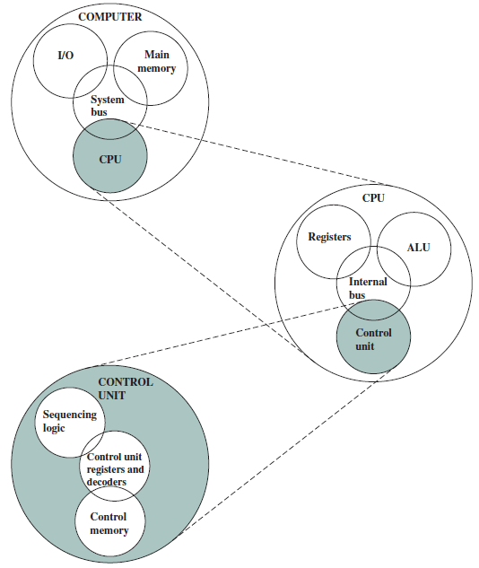

*Per-slide:* [`slides/slide-07.md`](slides/slide-07.md)

---

## 08. Computer Components {#08-computer-components}

**Four main structural components:**
- Central processing unit (CPU): controls the operation of the computer and performs its data
- processing functions; often simply referred to as processor
- Main memory: stores data
- I/O: moves data between the computer and its external environment
- System interconnection: some mechanism that provides for communication among CPU,
- main memory, and I/O

*Per-slide:* [`slides/slide-08.md`](slides/slide-08.md)

---

## 09. CPU Components {#09-cpu-components}

**Major structural components:**
- Control unit: controls the operation of the CPU and hence the computer
- Arithmetic and logic unit (ALU): performs the computer's data processing functions
- Registers: provide storage internal to the CPU
- CPU interconnection: some mechanism that provides for communication among the control
- unit, ALU, and registers

*Per-slide:* [`slides/slide-09.md`](slides/slide-09.md)

---

## 10. Multicore Computer Structure {#10-multicore-computer-structure}

- Contemporary computers have multiple processors.
- When these processors reside on a single chip
- Multicore computer
- Each processing unit (control unit, ALU, registers, cache) is a core.

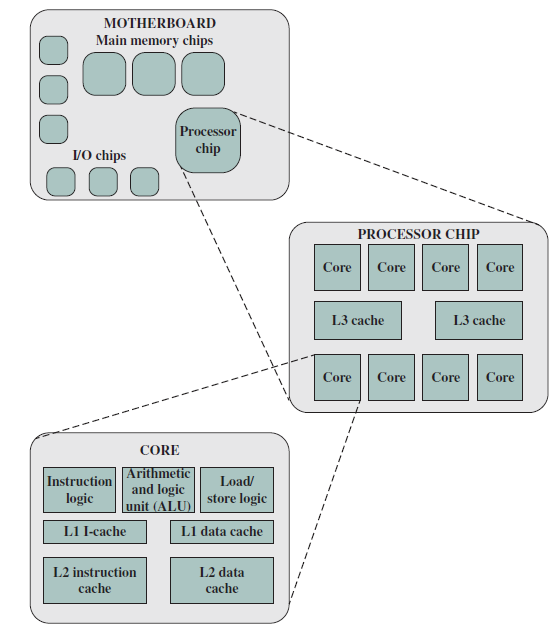

*Per-slide:* [`slides/slide-10.md`](slides/slide-10.md)

---

## 11. ENIAC - Background {#11-eniac-background}

- Electronic Numerical Integrator And Computer
- World's first general purpose electronic digital computer
- Eckert and Mauchly
- University of Pennsylvania
- Trajectory tables for weapons
- Started 1943
- Finished 1946
- Too late for war effort
- Perform a series of complex calculations to determine feasibility of the hydrogen bomb
- Used until 1955

*Per-slide:* [`slides/slide-11.md`](slides/slide-11.md)

---

## 12. Two early programmers (Gloria Ruth Gordon [Bolotsky] and Esther Gerston) at work on the ENIAC {#12-two-early-programmers-gloria-ruth-gordon-bolotsky-and-esther}

- US Army photo from the archives of the ARL Library (US Army Research Laboratory)

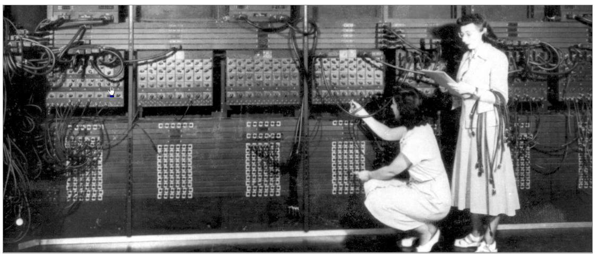

*Per-slide:* [`slides/slide-12.md`](slides/slide-12.md)

---

## 13. ENIAC - Details {#13-eniac-details}

- Decimal (not binary)
- 20 accumulators of 10 digits
- Programmed manually by switches
- 18,000 vacuum tubes
- 30 tons
- 1500 square feet
- 140 kW power consumption
- 5,000 additions per second
- Glenn A. Beck (background) and Betty Snyder (foreground)
- program ENIAC in BRL building 328
- (U.S. Army photo, c. 1947-1955)
- Image from Wikepedia

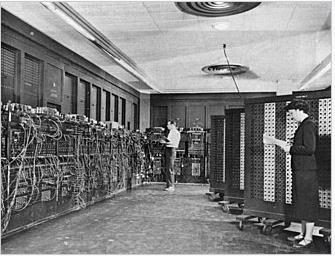

*Per-slide:* [`slides/slide-13.md`](slides/slide-13.md)

---

## 14. Von Neumann / Turing {#14-von-neumann-turing}

- Stored program concept
- Main memory storing programs and data
- ALU operating on binary data
- Control unit interpreting instructions from memory and executing
- Input and output equipment operated by control unit
- Princeton Institute for Advanced Studies
- IAS in 1946
- Completed 1952
- Structure of von Neumann Machine

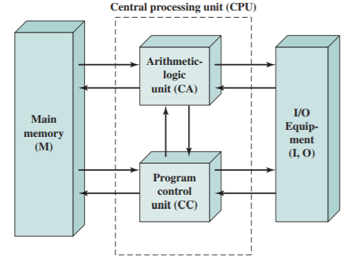

*Per-slide:* [`slides/slide-14.md`](slides/slide-14.md)

---

## 15. IAS - Details {#15-ias-details}

- Memory consists of 4096 x 40 bit words
- Binary numbers
- 2 x 20 bit instructions
- Memory formats

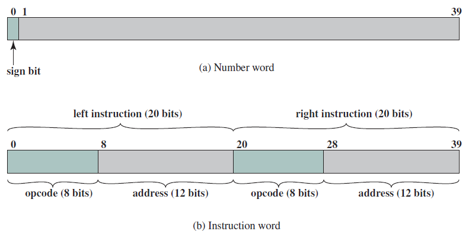

*Per-slide:* [`slides/slide-15.md`](slides/slide-15.md)

---

## 16. IAS - Details {#16-ias-details}

**Set of registers (storage in CPU):**
- Memory buffer register (MBR): Contains a word to
- be stored in memory or sent to the I/O unit, or is used
- to receive a word from memory or from the I/O unit.
- Memory address register (MAR): Specifies the
- address in memory of the word to be written from or
- read into the MBR.
- Instruction register (IR): Contains the 8-bit opcode
- instruction being executed.
- Instruction buffer register (IBR): Holds temporarily
- the righthand instruction from a word in memory.
- Program counter (PC): Contains the address of the
- next instruction pair to be fetched from memory.
- Accumulator (AC) and multiplier quotient (MQ):
- Hold
- temporarily
- operands
- and
- results
- of
- ALU
- operations.

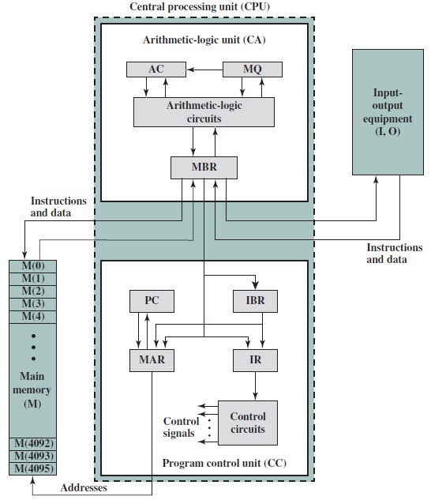

*Per-slide:* [`slides/slide-16.md`](slides/slide-16.md)

---

## 17. Example: {#17-example}

- Load M(x)
- Add M(y)
- Store M(z)

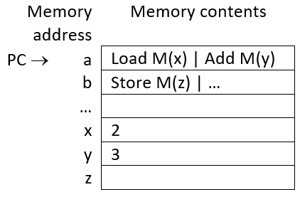

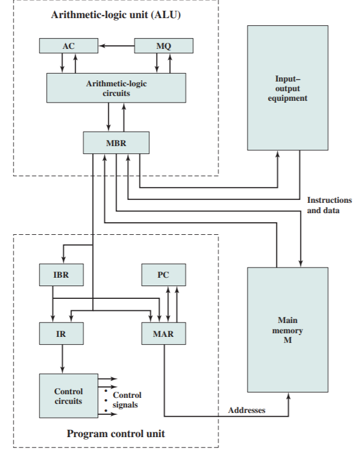

*Per-slide:* [`slides/slide-17.md`](slides/slide-17.md)

---

## 18. IAS {#18-ias}

- Instruction
- Set

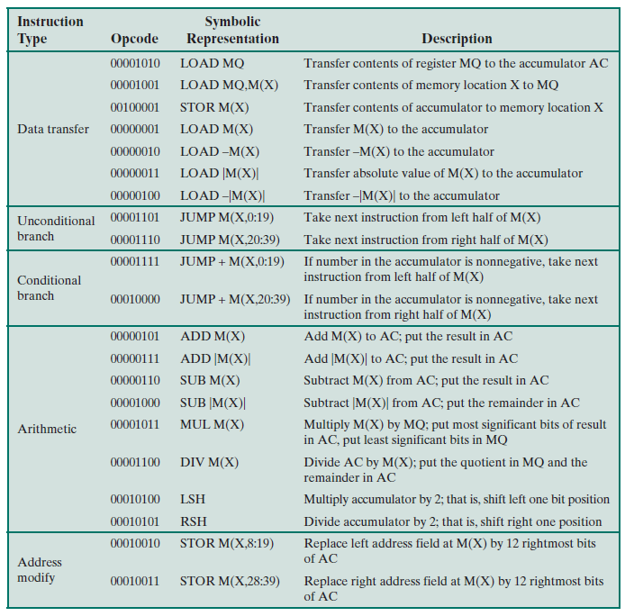

*Per-slide:* [`slides/slide-18.md`](slides/slide-18.md)

---

## 19. Problem 1.2 {#19-problem-1-2}

- a)
- On the IAS, what would the machine code instruction look like to store the contents of an
- accumulator to memory address 8?
- b)
- On the IAS, what would the machine code instruction look like to add the contents of memory
- address 16 to the accumulator?

*Per-slide:* [`slides/slide-19.md`](slides/slide-19.md)

---

## 20. Solution {#20-solution}

- a)
- STOR M(8)
- b)
- ADD M(16)
- Transfer contents of accumulator to
- memory location X
- Add M(X) to AC; put result in AC
- Refer to slide 18 for IAS instruction set

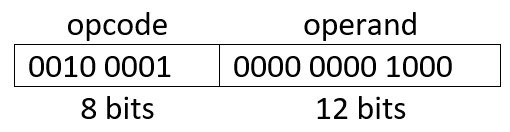

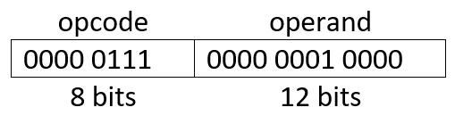

*Per-slide:* [`slides/slide-20.md`](slides/slide-20.md)

---

## 21. Problem 1.4 (from previous book edition) {#21-problem-1-4-from-previous-book-edition}

- Given the memory contents of the IAS computer shown below, show the assembly language
- code for the program starting at address 08A.
- Explain what this program does.
- Address
- Contents
- 08A
- 010FA210FB
- 08B
- 010FA0F08D
- 08C
- 020FA210FB

*Per-slide:* [`slides/slide-21.md`](slides/slide-21.md)

---

## 22. Solution {#22-solution}

- The program will store the absolute value of the content at memory location 0FA into memory
- location 0FB.

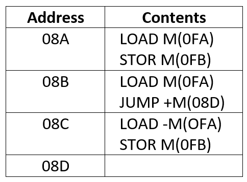

*Per-slide:* [`slides/slide-22.md`](slides/slide-22.md)

---

## 23. Commercial Computers {#23-commercial-computers}

- 1947 - Eckert-Mauchly Computer Corporation
- UNIVAC I (Universal Automatic Computer)
- US Bureau of Census 1950 calculations
- Became part of Sperry-Rand Corporation
- Late 1950s - UNIVAC II
- Faster
- More memory

*Per-slide:* [`slides/slide-23.md`](slides/slide-23.md)

---

## 24. IBM {#24-ibm}

- Punched card processing equipment
- 1953 - the 701
- IBM's first stored program computer
- Scientific calculations
- 1955 - the 702
- Business applications
- Lead to 700/7000 series

*Per-slide:* [`slides/slide-24.md`](slides/slide-24.md)

---

## 25. Transistors {#25-transistors}

- A transistor is an on/off switch controlled by electricity
- Replaced vacuum tubes
- Smaller
- Cheaper
- Less heat dissipation
- Solid State device
- Made from Silicon (sand)
- Invented 1947 at Bell Labs
- William Shockley et al.

*Per-slide:* [`slides/slide-25.md`](slides/slide-25.md)

---

## 26. Transistor Based Computers {#26-transistor-based-computers}

- Second generation machines
- NCR and RCA produced small transistor machines
- IBM 7000
- DEC (Digital Equipment Corporation) - 1957
- Produced PDP - 1

*Per-slide:* [`slides/slide-26.md`](slides/slide-26.md)

---

## 27. Microelectronics {#27-microelectronics}

- Literally - small electronics
- A computer is made of gates, memory cells, and interconnections
- These can be manufactured on a semiconductor
- e.g. silicon wafer

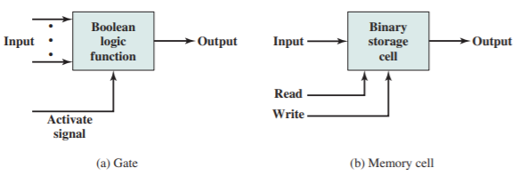

*Per-slide:* [`slides/slide-27.md`](slides/slide-27.md)

---

## 28. Generations of Computers {#28-generations-of-computers}

- The integrated circuit (IC) combined dozens to hundreds of transistors into a single chip.
- A VLSI circuit is just billions of combinations of conductors, insulators, and switches
- manufactured in a single small package.

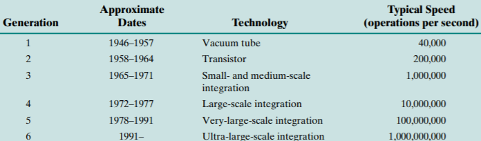

*Per-slide:* [`slides/slide-28.md`](slides/slide-28.md)

---

## 29. Moore's Law {#29-moore-s-law}

- Increased density of components on chip
- Gordon Moore - co-founder of Intel
- Number of transistors on a chip will double every year
- Since 1970's, development has slowed a little
- Number of transistors doubles every 18 months
- Cost of chip has remained almost unchanged
- Higher packing density means shorter electrical paths, giving higher performance
- Smaller size gives increased flexibility
- Reduced power and cooling requirements
- Fewer interconnections increases reliability

*Per-slide:* [`slides/slide-29.md`](slides/slide-29.md)

---

## 30. Slide 30 (figure) {#30-slide-30-figure}

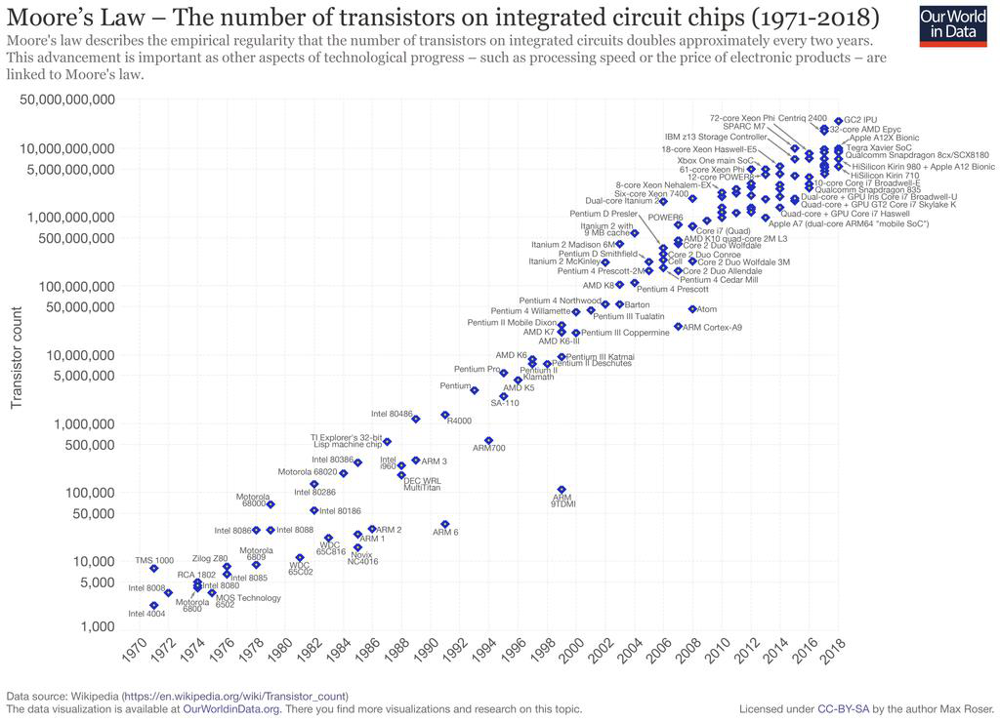

*Per-slide:* [`slides/slide-30.md`](slides/slide-30.md)

---

## 31. IBM 360 Series {#31-ibm-360-series}

- 1964
- Replaced and not compatible with 7000 series
- First planned 'family' of computers
- Similar or identical instruction sets
- Similar or identical OS
- Increasing speed
- Increasing number of I/O ports (more terminals)
- Increasing memory size
- Increasing cost
- Multiplexed switch structure

*Per-slide:* [`slides/slide-31.md`](slides/slide-31.md)

---

## 32. DEC PDP-8 {#32-dec-pdp-8}

- 1964
- First minicomputer
- Did not need air conditioned room
- Small enough to sit on a lab bench

**Bus structure:**
- Console
- controller
- CPU
- Main
- Memory
- I/O
- Module
- I/O
- Module
- OMNIBUS
- Cost
- $16,000
- Compared to $100k+ for IBM 360
- Embedded applications and OEM

*Per-slide:* [`slides/slide-32.md`](slides/slide-32.md)

---

## 33. Semiconductor Memory {#33-semiconductor-memory}

- 1970
- Fairchild
- Size of a single core
- i.e. 1 bit of magnetic core storage
- Holds 256 bits
- Much faster than core
- Capacity approximately doubles each year

*Per-slide:* [`slides/slide-33.md`](slides/slide-33.md)

---

## 34. Intel {#34-intel}

- 1971 - 4004
- First microprocessor
- All CPU components on a single chip
- 4 bit
- Followed in 1972 by 8008
- 8 bit
- Both designed for specific applications
- 1974 - 8080
- Intel's first general purpose microprocessor

*Per-slide:* [`slides/slide-34.md`](slides/slide-34.md)

---

## 35. CISC vs RISC {#35-cisc-vs-risc}

- CISC: Complex Instruction Set Computers
- E.g. Intel's x86
- RISC: Reduced Instruction Set Computers
- E.g. ARM architecture
- Consider the high level statement: A = B + C
- On a typical CISC machine: add mem(A), mem(B), mem(C)

**On a typical RISC machine:**
- load mem(B), reg(1)
- load mem(C), reg(2)
- add reg(1), reg(1), reg(2)
- store reg(1), mem(A)

*Per-slide:* [`slides/slide-35.md`](slides/slide-35.md)

---

## 36. Evolution of the Intel x86 Architecture {#36-evolution-of-the-intel-x86-architecture}

**8080:**
- first general-purpose microprocessor
- 8 bit data path
- used in the first personal computer, the Altair.

**8086:**
- far more powerful
- 16-bit machine
- instruction cache, prefetch a few instructions
- variant: the 8088: 8 bit external bus, used in first IBM PC

**80286:**
- 16-MByte memory addressable
- up from 1 Mb

**80386:**
- 32 bit
- support for multitasking

*Per-slide:* [`slides/slide-36.md`](slides/slide-36.md)

---

## 37. Evolution of the Intel x86 Architecture {#37-evolution-of-the-intel-x86-architecture}

**80486:**
- sophisticated and powerful cache technology and instruction pipelining
- built-in math coprocessor

**Pentium:**
- superscalar techniques
- multiple instructions executed in parallel

**Pentium Pro:**
- increased superscalar
- aggressive register renaming
- branch prediction
- data flow analysis
- speculative execution

*Per-slide:* [`slides/slide-37.md`](slides/slide-37.md)

---

## 38. Evolution of the Intel x86 Architecture {#38-evolution-of-the-intel-x86-architecture}

**Pentium II:**
- MMX technology
- process video, audio, and graphics data efficiently

**Pentium III:**
- additional floating-point instructions to support 3D graphics software

**Pentium 4:**
- additional floating-point and multimedia enhancements

**Core:**
- dual core: implementation of two processors on a single chip

**Core 2:**
- 64 bits
- Core 2 Quad provides four cores on a single chip
- more recent Core offerings have up to 10 cores per chip
- Advanced Vector instruction sets of 256 and 512-bit instructions for vector data

*Per-slide:* [`slides/slide-38.md`](slides/slide-38.md)

---

## 39. Embedded Systems {#39-embedded-systems}

- A computer inside another device used for running one predetermined application or collection of
- software
- the microprocessors found in your car, the computers in a television set, and the networks of
- processors that control a modern airplane or cargo ship
- Designed to run one application or one set of related applications that are normally integrated
- with the hardware and delivered as a single system
- Consider a music player: the processor need only be as fast as necessary to handle its limited
- function, and beyond that, minimizing cost and power are the most important objectives
- Have lower tolerance for failure
- Your new tv crashes
- Computer in a plane or cargo ship crashes
- Dependability is achieved primarily through simplicity, emphasis is on doing one function as
- perfectly as possible

*Per-slide:* [`slides/slide-39.md`](slides/slide-39.md)

---

## 40. Possible Organization of an Embedded System {#40-possible-organization-of-an-embedded-system}

- Elements that differ from the typical desktop or laptop

**computer:**
- variety of interfaces that enable the system to
- measure, manipulate, and interact with external
- environment
- human interface may be as simple as a flashing
- light or as complicated as real-time robotic vision
- diagnostic port may be used for diagnosing the
- system
- that
- is
- being
- controlled-not
- just
- for
- diagnosing the computer
- special-purpose
- field
- programmable
- (FPGA),
- application specific (ASIC), or even nondigital
- hardware may be used to increase performance or
- safety

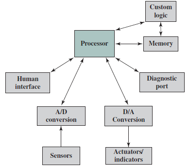

*Per-slide:* [`slides/slide-40.md`](slides/slide-40.md)

---

## 41. Microprocessors vs Microcontrollers {#41-microprocessors-vs-microcontrollers}

- Early microprocessor chips included
- registers, an ALU, and some sort of control
- unit.
- Contemporary microprocessor chips include
- multiple cores and a substantial amount of
- cache memory.
- A microcontroller is a single chip that
- contains the processor, non-volatile memory
- for the program (ROM), volatile memory for
- input and output (RAM), a clock, and an I/O
- control unit.
- The processor portion of the
- microcontroller has a much lower silicon
- area than other microprocessors and
- much higher energy efficiency.
- Typical Microcontroller Chip Elements

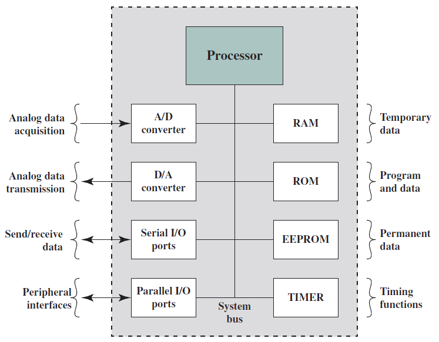

*Per-slide:* [`slides/slide-41.md`](slides/slide-41.md)

---

## 42. ARM Architecture {#42-arm-architecture}

- RISC-based microprocessors and microcontrollers
- Used in embedded systems
- Company
- doesn't
- make
- processors
- but
- instead
- designs
- microprocessor
- and
- multicore
- architectures and licenses them to manufacturers
- High-speed processors
- Small die size
- Low power requirements
- Widely used in PDAs and other handheld devices, including games and phones as well as a
- large variety of consumer products
- Instruction Set Architecture: instructions are 32 bits long

*Per-slide:* [`slides/slide-42.md`](slides/slide-42.md)

---

## 43. Cloud Computing {#43-cloud-computing}

- Refers to large collections of servers that provide services over the Internet
- Relies upon giant datacenters known as Warehouse Scale Computers (WSCs)
- Companies like Amazon and Google build these WSCs containing 100,000 servers and then let
- companies rent portions of them so that they can provide software services to PMDs without
- having to build WSCs of their own

**Cloud services:**
- Software as a Service (SaaS) provides service to customers in the form of software
- Platform as a Service (PaaS) provides service to customers in the form of a platform on
- which the customer's applications can run
- Infrastructure as a Service (IaaS) provides processing, storage, networks,…

*Per-slide:* [`slides/slide-43.md`](slides/slide-43.md)

---
