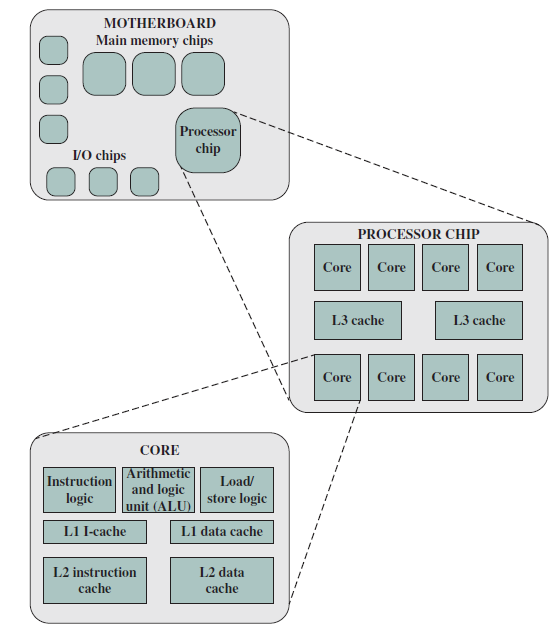

# Slide 10: Multicore Computer Structure

*Chapter 1 — Basic Concepts & Computer Evolution*

- Contemporary computers have multiple processors.
- When these processors reside on a single chip
- Multicore computer
- Each processing unit (control unit, ALU, registers, cache) is a core.

### Figures

