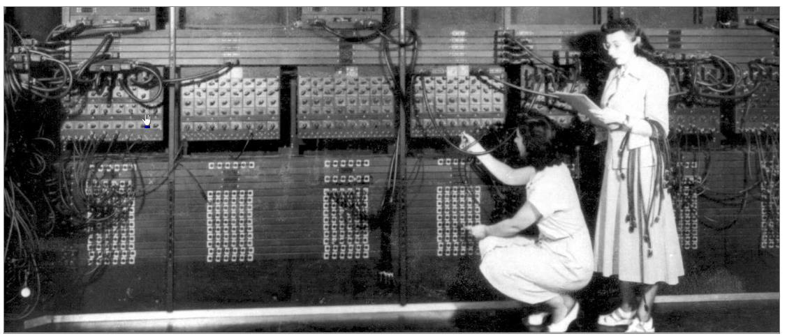

# Slide 12: Two early programmers (Gloria Ruth Gordon [Bolotsky] and Esther Gerston) at work on the ENIAC

*Chapter 1 — Basic Concepts & Computer Evolution*

- US Army photo from the archives of the ARL Library (US Army Research Laboratory)

### Figures

