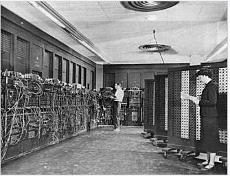

# Slide 13: ENIAC - Details

*Chapter 1 — Basic Concepts & Computer Evolution*

- Decimal (not binary)
- 20 accumulators of 10 digits
- Programmed manually by switches
- 18,000 vacuum tubes
- 30 tons
- 1500 square feet
- 140 kW power consumption
- 5,000 additions per second
- Glenn A. Beck (background) and Betty Snyder (foreground)
- program ENIAC in BRL building 328
- (U.S. Army photo, c. 1947-1955)
- Image from Wikepedia

### Figures

