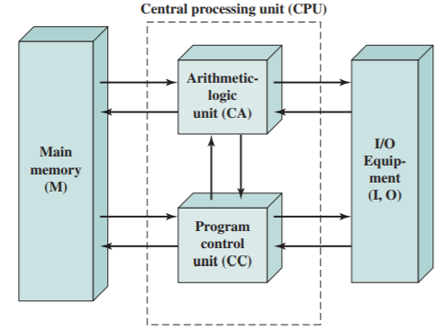

# Slide 14: Von Neumann / Turing

*Chapter 1 — Basic Concepts & Computer Evolution*

- Stored program concept
- Main memory storing programs and data
- ALU operating on binary data
- Control unit interpreting instructions from memory and executing
- Input and output equipment operated by control unit
- Princeton Institute for Advanced Studies
- IAS in 1946
- Completed 1952
- Structure of von Neumann Machine

### Figures

