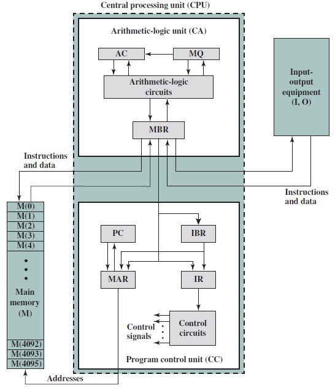

# Slide 16: IAS - Details

*Chapter 1 — Basic Concepts & Computer Evolution*

**Set of registers (storage in CPU):**
- Memory buffer register (MBR): Contains a word to
- be stored in memory or sent to the I/O unit, or is used
- to receive a word from memory or from the I/O unit.
- Memory address register (MAR): Specifies the
- address in memory of the word to be written from or
- read into the MBR.
- Instruction register (IR): Contains the 8-bit opcode
- instruction being executed.
- Instruction buffer register (IBR): Holds temporarily
- the righthand instruction from a word in memory.
- Program counter (PC): Contains the address of the
- next instruction pair to be fetched from memory.
- Accumulator (AC) and multiplier quotient (MQ):
- Hold
- temporarily
- operands
- and
- results
- of
- ALU
- operations.

### Figures

