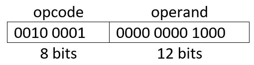
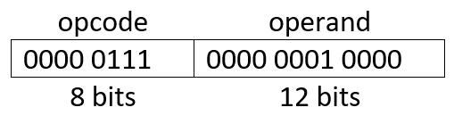

# Slide 20: Solution

*Chapter 1 — Basic Concepts & Computer Evolution*

- a)
- STOR M(8)
- b)
- ADD M(16)
- Transfer contents of accumulator to
- memory location X
- Add M(X) to AC; put result in AC
- Refer to slide 18 for IAS instruction set

### Figures

