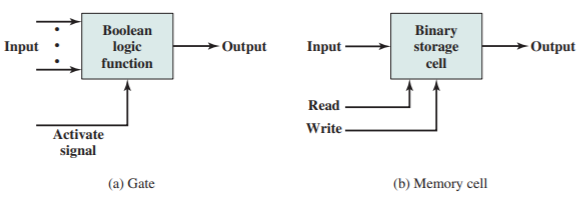

# Slide 27: Microelectronics

*Chapter 1 — Basic Concepts & Computer Evolution*

- Literally - small electronics
- A computer is made of gates, memory cells, and interconnections
- These can be manufactured on a semiconductor
- e.g. silicon wafer

### Figures

