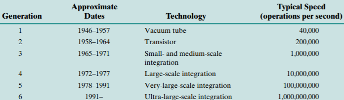

# Slide 28: Generations of Computers

*Chapter 1 — Basic Concepts & Computer Evolution*

- The integrated circuit (IC) combined dozens to hundreds of transistors into a single chip.
- A VLSI circuit is just billions of combinations of conductors, insulators, and switches
- manufactured in a single small package.

### Figures

