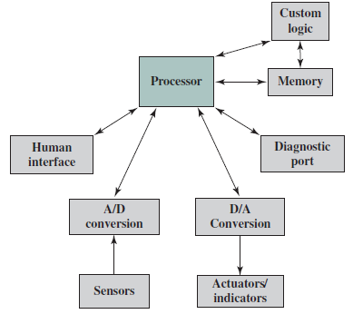

# Slide 40: Possible Organization of an Embedded System

*Chapter 1 — Basic Concepts & Computer Evolution*

- Elements that differ from the typical desktop or laptop

**computer:**
- variety of interfaces that enable the system to
- measure, manipulate, and interact with external
- environment
- human interface may be as simple as a flashing
- light or as complicated as real-time robotic vision
- diagnostic port may be used for diagnosing the
- system
- that
- is
- being
- controlled-not
- just
- for
- diagnosing the computer
- special-purpose
- field
- programmable
- (FPGA),
- application specific (ASIC), or even nondigital
- hardware may be used to increase performance or
- safety

### Figures

