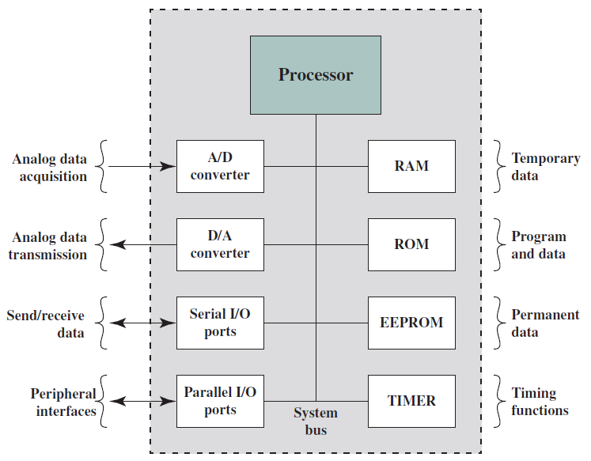

# Slide 41: Microprocessors vs Microcontrollers

*Chapter 1 — Basic Concepts & Computer Evolution*

- Early microprocessor chips included
- registers, an ALU, and some sort of control
- unit.
- Contemporary microprocessor chips include
- multiple cores and a substantial amount of
- cache memory.
- A microcontroller is a single chip that
- contains the processor, non-volatile memory
- for the program (ROM), volatile memory for
- input and output (RAM), a clock, and an I/O
- control unit.
- The processor portion of the
- microcontroller has a much lower silicon
- area than other microprocessors and
- much higher energy efficiency.
- Typical Microcontroller Chip Elements

### Figures

