# Chapter 2: Performance Issues

**Source:** `Chapter 2 - Performance Issues (1).pdf`  
**Pages / slides:** 38  
**Based on:** William Stallings, *Computer Organization and Architecture*

---

## Slide index

1. [Performance Issues](#01-performance-issues)
2. [Designing for Performance](#02-designing-for-performance)
3. [Some of the Applications Made Possible](#03-some-of-the-applications-made-possible)
4. [Speeding it up](#04-speeding-it-up)
5. [Performance Mismatch](#05-performance-mismatch)
6. [Solutions](#06-solutions)
7. [Improvements in Chip Organization and Architecture](#07-improvements-in-chip-organization-and-architecture)
8. [Problems with Clock Speed and Logic Density](#08-problems-with-clock-speed-and-logic-density)
9. [Multicore, MICs, GPGPUs](#09-multicore-mics-gpgpus)
10. [Performance](#10-performance)
11. [Performance and Execution Time](#11-performance-and-execution-time)
12. [Performance and Execution Time](#12-performance-and-execution-time)
13. [Relative Performance](#13-relative-performance)
14. [Measuring Performance](#14-measuring-performance)
15. [Clock Cycles](#15-clock-cycles)
16. [CPU Time](#16-cpu-time)
17. [Improving Performance](#17-improving-performance)
18. [Solution](#18-solution)
19. [Instruction Performance](#19-instruction-performance)
20. [Example](#20-example)
21. [Solution](#21-solution)
22. [CPU Performance Equation](#22-cpu-performance-equation)
23. [CPI in More Detail](#23-cpi-in-more-detail)
24. [Comparing Code Segments](#24-comparing-code-segments)
25. [Solution](#25-solution)
26. [The Big Picture](#26-the-big-picture)
27. [MIPS and MFLOPs](#27-mips-and-mflops)
28. [MIPS Example](#28-mips-example)
29. [Amdahl's Law](#29-amdahl-s-law)
30. [Amdahl's Law](#30-amdahl-s-law)
31. [Amdahl's Law - Example](#31-amdahl-s-law-example)
32. [Amdahl's Law - Speedup](#32-amdahl-s-law-speedup)
33. [Speedup Example](#33-speedup-example)
34. [Benchmarks](#34-benchmarks)
35. [System Performance Evaluation Corporation (SPEC)](#35-system-performance-evaluation-corporation-spec)
36. [SPEC CPU2017 Benchmarks](#36-spec-cpu2017-benchmarks)
37. [SPEC CPU2017 Integer Benchmarks](#37-spec-cpu2017-integer-benchmarks)
38. [SPEC CPU2017 Floating Point Benchmarks](#38-spec-cpu2017-floating-point-benchmarks)

---

## 01. Performance Issues {#01-performance-issues}

- Chapter 2

**Based on:**
- William Stallings
- Computer Organization and Architecture, 11th Global Edition
- Patterson and Hennessy
- Computer Organization and Design, 5th Edition

*Per-slide:* [`slides/slide-01.md`](slides/slide-01.md)

---

## 02. Designing for Performance {#02-designing-for-performance}

- Cost of computer systems continues to drop dramatically
- Performance and capacity continue to rise dramatically
- Laptops today have the computing power of an IBM mainframe from 10 to 15 years ago
- In the last 30 years or so, there has been a number of new computers whose introductions
- appeared to revolutionize the computer industry
- Race to innovate has led to unprecedented progress
- Had the transportation industry grown at a similar rate to the computer industry, today we could
- travel from New York to London in a second for a penny!

*Per-slide:* [`slides/slide-02.md`](slides/slide-02.md)

---

## 03. Some of the Applications Made Possible {#03-some-of-the-applications-made-possible}

- Computers in automobiles
- Microprocessors improved dramatically in price and performance in the early 1980s
- Until then, computer control of cars was ludicrous
- Today, computers reduce pollution, improve fuel efficiency, increase safety
- Cell phones
- More than half the planet have a mobile phone allowing person to person communication to
- anyone anywhere
- Human genome project
- Cost of computer equipment to map and analyze DNA sequences was hundreds of millions of
- dollars 15 to 25 years ago
- Search engines
- Content of the web has grown in size and value
- Finding relevant information has become important
- Digital presence

*Per-slide:* [`slides/slide-03.md`](slides/slide-03.md)

---

## 04. Speeding it up {#04-speeding-it-up}

- Pipelining
- On board cache
- Branch prediction
- Superscalar execution
- Data flow analysis
- Speculative execution

*Per-slide:* [`slides/slide-04.md`](slides/slide-04.md)

---

## 05. Performance Mismatch {#05-performance-mismatch}

- Processor speed increased
- Memory capacity increased
- Memory speed lags behind processor speed

*Per-slide:* [`slides/slide-05.md`](slides/slide-05.md)

---

## 06. Solutions {#06-solutions}

- Increase number of bits retrieved at one time
- Make DRAM 'wider' rather than 'deeper'
- Change DRAM interface
- Cache on DRAM chip
- Reduce frequency of memory accesses
- More complex cache and cache on chip
- Increase interconnection bandwidth
- High speed buses
- Hierarchy of buses

*Per-slide:* [`slides/slide-06.md`](slides/slide-06.md)

---

## 07. Improvements in Chip Organization and Architecture {#07-improvements-in-chip-organization-and-architecture}

- Increase the hardware speed of the processor
- Shrinking the size of the logic gates on the processor
- More gates can be packed together more tightly
- Propagation time for signals is reduced
- Increasing the clock rate
- Individual operations are executed more rapidly
- Increase the size and speed of caches
- Make changes to the processor organization and architecture
- Complex instruction execution logic to enable parallel execution

*Per-slide:* [`slides/slide-07.md`](slides/slide-07.md)

---

## 08. Problems with Clock Speed and Logic Density {#08-problems-with-clock-speed-and-logic-density}

- Power
- RC delay
- Components on chip ↓ in size
- Wire interconnects become thinner → R ↑
- Wires are closer together → C ↑
- RC product ↑ → delay ↑
- Memory latency and throughput

*Per-slide:* [`slides/slide-08.md`](slides/slide-08.md)

---

## 09. Multicore, MICs, GPGPUs {#09-multicore-mics-gpgpus}

- Multicore
- Placing multiple processors on the same chip, with a large shared cache
- Increases performance without increasing the clock rate
- Many Integrated Cores (MIC)
- Large number of cores
- More than 50 cores per chip
- General Purpose Computing on Graphics Processing Units (GPGPUs)
- Perform parallel operation on multiple sets of data

*Per-slide:* [`slides/slide-09.md`](slides/slide-09.md)

---

## 10. Performance {#10-performance}

- Accurately measuring and comparing different computers is critical to purchasers and therefore to
- designers.
- When we say one computer has better performance than another, what do we mean?
- If you were running a program on two different desktop computers, you'd say that the faster
- computer is the one that gets the job done first.
- As a pc user, you are interested in reducing response time-the time between the start and
- completion of a task-also referred to as execution time.
- If you were running a datacenter that had several servers running jobs submitted by many users,
- you'd say that the faster computer is the one that completed the most jobs during a day.
- Datacenter managers are often interested in increasing throughput -the total amount of
- work done in a given time.

*Per-slide:* [`slides/slide-10.md`](slides/slide-10.md)

---

## 11. Performance and Execution Time {#11-performance-and-execution-time}

- To maximize performance, we want to minimize execution time for some task.
- For two computers X and Y, if the performance of X is greater than the performance of Y:
- The execution time on Y is longer than that on X, if X is faster than Y.

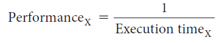

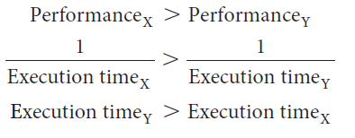

*Per-slide:* [`slides/slide-11.md`](slides/slide-11.md)

---

## 12. Performance and Execution Time {#12-performance-and-execution-time}

- In discussing a computer design, we often want to relate the performance of two different
- computers quantitatively. We will use the phrase "X is n times faster than Y" or equivalently "X is n

**times as fast as Y" to mean:**
- If X is n times as fast as Y, then the execution time on Y is n times as long as it is on X:
- We usually say "improve performance" or "improve execution time" when we mean "increase
- performance" and "decrease execution time."

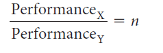

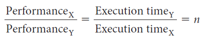

*Per-slide:* [`slides/slide-12.md`](slides/slide-12.md)

---

## 13. Relative Performance {#13-relative-performance}

- If computer A runs a program in 10 seconds and computer B runs the same program in 15
- seconds, how much faster is A than B?

**We know that A is n times as fast as B if:**
- The performance ratio is 15 / 10 = 1.5
- A is therefore 1.5 times as fast as B
- We could also say that computer B is 1.5 times slower than computer A, since
- means that

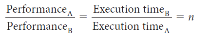

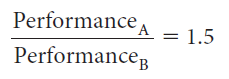

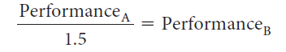

*Per-slide:* [`slides/slide-13.md`](slides/slide-13.md)

---

## 14. Measuring Performance {#14-measuring-performance}

- Program execution time is measured in seconds per program.
- Time can be defined in different ways, depending on what we count.
- wall clock time, response time, or elapsed time
- total time to complete a task, including disk accesses, memory accesses, I/O activities, OS
- overhead
- A processor may work on several programs simultaneously.
- CPU execution time or CPU time is the time the CPU spends computing for this task and does
- not include time spent waiting for I/O or running other programs.

*Per-slide:* [`slides/slide-14.md`](slides/slide-14.md)

---

## 15. Clock Cycles {#15-clock-cycles}

- Almost all computers are constructed using a clock that determines when events take place in the
- hardware.
- These discrete time intervals are called clock cycles.
- We refer to the length of a clock period both as the time for a complete clock cycle (e.g. 250
- picoseconds) and as the clock rate (e.g., 4 gigahertz), which is the inverse of the clock period.

*Per-slide:* [`slides/slide-15.md`](slides/slide-15.md)

---

## 16. CPU Time {#16-cpu-time}

**CPU time:**

**Since clock rate and clock cycle time are inverses:**

**Performance improved by:**
- Reducing number of clock cycles
- Increasing clock rate

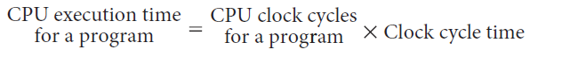

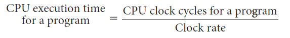

*Per-slide:* [`slides/slide-16.md`](slides/slide-16.md)

---

## 17. Improving Performance {#17-improving-performance}

- Our favorite program runs in 10 seconds on computer A, which has a 2 GHz clock.
- We are trying to help a computer designer build a computer, B, which will run this program in 6
- seconds.
- The designer has determined that a substantial increase in the clock rate is possible, but this
- increase will affect the rest of the CPU design, causing computer B to require 1.2 times as many
- clock cycles as computer A for this program.
- What clock rate should we tell the designer to target?

*Per-slide:* [`slides/slide-17.md`](slides/slide-17.md)

---

## 18. Solution {#18-solution}

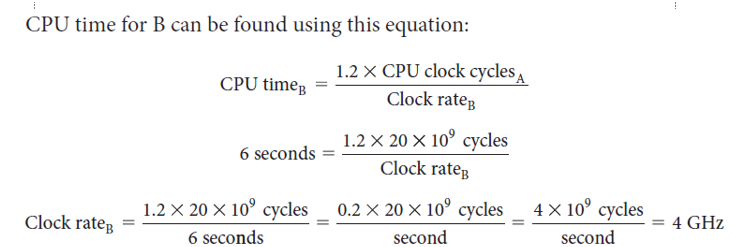

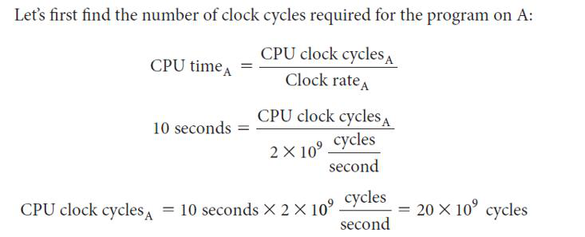

*Per-slide:* [`slides/slide-18.md`](slides/slide-18.md)

---

## 19. Instruction Performance {#19-instruction-performance}

- Since the computer has to execute the instructions to run the program, the execution time must
- depend on the number of instructions in a program.
- Execution time equals the number of instructions executed multiplied by the average time per
- instruction.

**The number of clock cycles:**
- Clock cycles per instruction (CPI) is the average number of clock cycles each instruction takes
- to execute.
- Since different instructions may take different amounts of time depending on what they do, CPI is
- an average of all the instructions executed in the program.

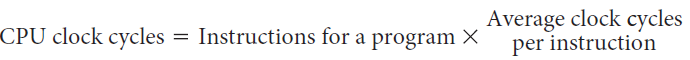

*Per-slide:* [`slides/slide-19.md`](slides/slide-19.md)

---

## 20. Example {#20-example}

- Suppose we have two implementations of the same instruction set architecture.
- Computer A has a clock cycle time of 250 ps and a CPI of 2.0 for some program, and computer B
- has a clock cycle time of 500 ps and a CPI of 1.2 for the same program.
- Which computer is faster for this program and by how much?

*Per-slide:* [`slides/slide-20.md`](slides/slide-20.md)

---

## 21. Solution {#21-solution}

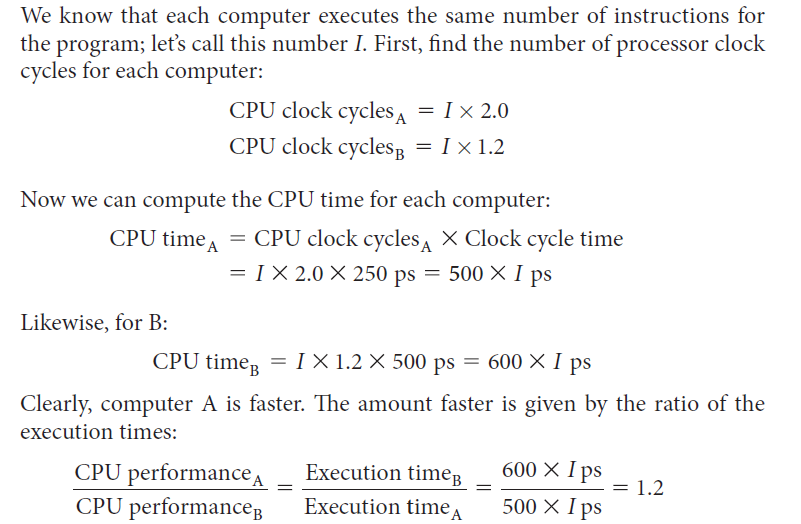

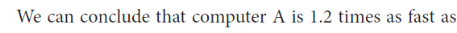

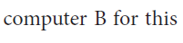

*Per-slide:* [`slides/slide-21.md`](slides/slide-21.md)

---

## 22. CPU Performance Equation {#22-cpu-performance-equation}

- We can write this basic performance equation in terms of instruction count, CPI, and clock
- cycle time
- 𝐶𝑃𝑈𝑡𝑖𝑚𝑒= 𝑖𝑛𝑠𝑡𝑟𝑢𝑐𝑡𝑖𝑜𝑛𝑐𝑜𝑢𝑛𝑡× 𝐶𝑃𝐼× 𝑐𝑙𝑜𝑐𝑘𝑐𝑦𝑐𝑙𝑒𝑡𝑖𝑚𝑒

**Since the clock rate is the inverse of the clock cycle time:**
- 𝐶𝑃𝑈𝑡𝑖𝑚𝑒= 𝑖𝑛𝑠𝑡𝑟𝑢𝑐𝑡𝑖𝑜𝑛𝑐𝑜𝑢𝑛𝑡× 𝐶𝑃𝐼
- 𝑐𝑙𝑜𝑐𝑘𝑟𝑎𝑡𝑒

*Per-slide:* [`slides/slide-22.md`](slides/slide-22.md)

---

## 23. CPI in More Detail {#23-cpi-in-more-detail}

- If different instruction classes take different numbers of cycles
- Weighted average CPI
- 
- =
- 
- =
- n
- i
- i
- i
- )
- Count
- n
- Instructio
- (CPI
- Cycles
- Clock
- 
- =
- 
- 
- 
- 
- 
- 
- 
- =
- =
- n
- i
- i
- i
- Count
- n
- Instructio
- Count
- n
- Instructio
- CPI
- Count
- n
- Instructio
- Cycles
- Clock
- CPI

*Per-slide:* [`slides/slide-23.md`](slides/slide-23.md)

---

## 24. Comparing Code Segments {#24-comparing-code-segments}

- A compiler designer is trying to decide between two code sequences for a particular computer. The

**hardware designers have supplied the following facts:**
- For a particular high-level language statement, the compiler writer is considering two code

**sequences that require the following instruction counts:**
- Which code sequence executes the
- most instructions?
- Which will be faster? What is the CPI for each sequence?
- CPI for each instruction class
- A
- B
- C
- CPI
- Code sequence
- Instruction counts for each instruction class
- A
- B
- C

*Per-slide:* [`slides/slide-24.md`](slides/slide-24.md)

---

## 25. Solution {#25-solution}

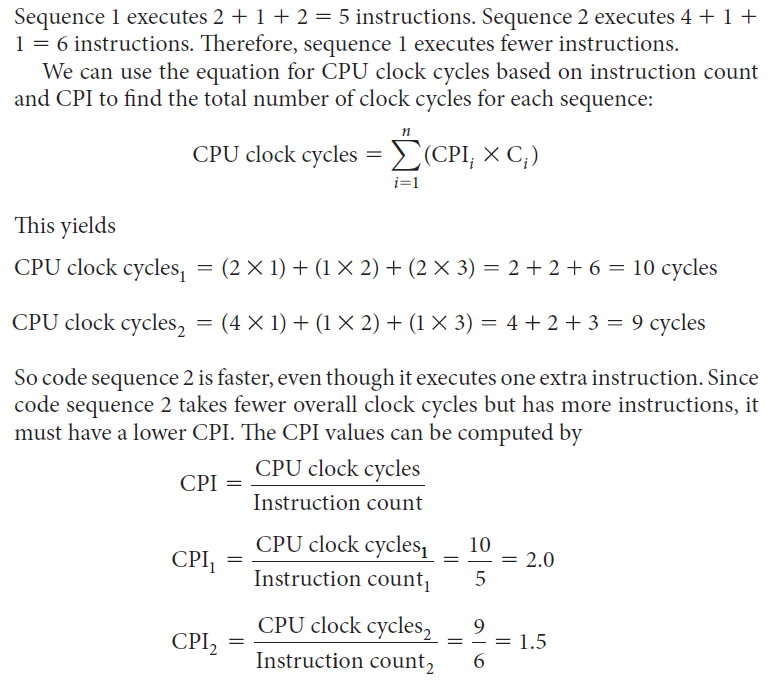

*Per-slide:* [`slides/slide-25.md`](slides/slide-25.md)

---

## 26. The Big Picture {#26-the-big-picture}

- Basic measurements at different levels and what is being measured in each case
- These factors are combined to yield execution time measured in seconds per program
- 𝑇𝑖𝑚𝑒= 𝑠𝑒𝑐𝑜𝑛𝑑𝑠
- 𝑝𝑟𝑜𝑔𝑟𝑎𝑚= 𝑖𝑛𝑠𝑡𝑟𝑢𝑐𝑡𝑖𝑜𝑛𝑠
- 𝑝𝑟𝑜𝑔𝑟𝑎𝑚
- × 𝑐𝑙𝑜𝑐𝑘𝑐𝑦𝑐𝑙𝑒𝑠
- 𝑖𝑛𝑠𝑡𝑟𝑢𝑐𝑡𝑖𝑜𝑛×
- 𝑠𝑒𝑐𝑜𝑛𝑑𝑠
- 𝑐𝑙𝑜𝑐𝑘𝑐𝑦𝑐𝑙𝑒
- Components of performance
- Units of measure
- How they're measured
- CPU execution time for a
- program
- Seconds for the program
- running the program
- Instruction count
- Instructions executed for the program sw tools, simulator, hw counters
- Clock cycles per instruction
- (CPI)
- Avg number of clock cycles per
- instruction
- hw counters
- Clock cycle time
- Seconds per clock cycle
- documentation

*Per-slide:* [`slides/slide-26.md`](slides/slide-26.md)

---

## 27. MIPS and MFLOPs {#27-mips-and-mflops}

- MIPS
- millions of instructions per second
- instruction execution rate
- expressed in terms of the clock rate and CPI :
- 𝑀𝐼𝑃𝑆𝑟𝑎𝑡𝑒=
- 𝑖𝑛𝑠𝑡𝑟𝑢𝑐𝑡𝑖𝑜𝑛𝑐𝑜𝑢𝑛𝑡
- 𝑒𝑥𝑒𝑐𝑢𝑡𝑖𝑜𝑛𝑡𝑖𝑚𝑒× 106 = 𝑐𝑙𝑜𝑐𝑘𝑟𝑎𝑡𝑒
- 𝐶𝑃𝐼× 106
- MFLOPS
- millions of floating-point operations per second
- performance measure that deals only with FP instructions
- common in many scientific and game applications
- expressed as
- 𝑀𝐹𝐿𝑂𝑃𝑠𝑟𝑎𝑡𝑒= 𝑛𝑢𝑚𝑏𝑒𝑟𝑜𝑓𝑒𝑥𝑒𝑐𝑢𝑡𝑒𝑑𝐹𝑃𝑜𝑝𝑒𝑟𝑎𝑡𝑖𝑜𝑛𝑠𝑖𝑛𝑎𝑝𝑟𝑜𝑔𝑟𝑎𝑚
- 𝑒𝑥𝑒𝑐𝑢𝑡𝑖𝑜𝑛𝑡𝑖𝑚𝑒× 106
- Pitfall: Using a subset
- of the performance
- equation as a
- performance metric.
- Execution time is the
- only valid and
- unimpeachable
- measure of
- performance.

*Per-slide:* [`slides/slide-27.md`](slides/slide-27.md)

---

## 28. MIPS Example {#28-mips-example}

- Consider the execution of a program that results in the execution of 2 million instructions on a 400-
- MHz processor.
- The program consists of four major types of instructions.
- The instruction mix and the CPI for each instruction type are given below based on the result of a

**program trace experiment:**
- The average CPI = 0.6 + (2 x 0.18) + (4 x 0.12) + (8 x 0.1) = 2.24
- The corresponding MIPS rate is (400 x 106)/(2.24 x 106) ≈178
- Instruction type
- CPI
- Instruction mix (%)
- Arithmetic and logic
- Load/store with cache hit
- Branch
- Memory reference with cache miss

*Per-slide:* [`slides/slide-28.md`](slides/slide-28.md)

---

## 29. Amdahl's Law {#29-amdahl-s-law}

- Assume
- we
- want
- to
- parallelize
- an
- application
- We would expect that doubling the number
- of
- processing
- units
- should
- halve
- the
- parallel execution time.
- We would expect that the speedup from
- parallelization would be a linear function of
- the number of processing units.
- Let P be a sequential program processing

**files from disk:**
- P1 scans the directory of the disk, creates
- a list of file names, and hands the list over
- to P2
- P2 passes each file to the processing unit
- for processing
- Note: P1 cannot be sped up by adding new
- processing units, because scanning the disk
- directory is a sequential process. P2 can be
- sped up.
- Suppose the sequential execution of P takes
- 100 s
- the non-parallelizable P1 runs 20 s
- the parallelizable P2 runs 80 s
- Motivation
- Example

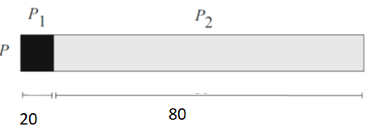

*Per-slide:* [`slides/slide-29.md`](slides/slide-29.md)

---

## 30. Amdahl's Law {#30-amdahl-s-law}

- The execution time of the program after making the improvement is given by Amdahl's Law:
- Amdahl's Law: A rule stating that the performance enhancement possible with a given
- improvement is limited by the amount that the improved feature is used.

**For the previous example, suppose we parallelize over 2 processing units:**
- Execution time after improvement = 80/2 + 20 = 60 s.
- Execution time after improvement
- + execution time unaffected
- =
- execution time affected by improvement
- amount of improvement

*Per-slide:* [`slides/slide-30.md`](slides/slide-30.md)

---

## 31. Amdahl's Law - Example {#31-amdahl-s-law-example}

- By how much do I have to improve the speed of P2 if I want my program to run five times faster?
- 𝑒𝑥𝑒𝑐𝑢𝑡𝑖𝑜𝑛𝑡𝑖𝑚𝑒𝑎𝑓𝑡𝑒𝑟𝑖𝑚𝑝𝑟𝑜𝑣𝑒𝑚𝑒𝑛𝑡= 80 𝑠𝑒𝑐
- 𝑛
- + (100 −80 𝑠𝑒𝑐)
- Since we want the performance to be five times faster, the new execution time should be 20 s
- 20 𝑠𝑒𝑐= 80 𝑠𝑒𝑐
- 𝑛
- + 20 𝑠𝑒𝑐
- There is no amount by which we can enhance to achieve a five-fold increase in performance.
- Performance enhancement possible with a given improvement is limited by the amount that the
- improved feature is used.
- 0 = 80 𝑠𝑒𝑐
- 𝑛

*Per-slide:* [`slides/slide-31.md`](slides/slide-31.md)

---

## 32. Amdahl's Law - Speedup {#32-amdahl-s-law-speedup}

- Deals with the potential speedup of a program using multiple processors compared to a single

**processor:**
- 𝑆𝑝𝑒𝑒𝑑𝑢𝑝=
- 𝑇𝑖𝑚𝑒𝑡𝑜𝑒𝑥𝑒𝑐𝑢𝑡𝑒𝑝𝑟𝑜𝑔𝑟𝑎𝑚𝑜𝑛𝑎𝑠𝑖𝑛𝑔𝑙𝑒𝑝𝑟𝑜𝑐𝑒𝑠𝑠𝑜𝑟
- 𝑇𝑖𝑚𝑒𝑡𝑜𝑒𝑥𝑒𝑐𝑢𝑡𝑒𝑝𝑟𝑜𝑔𝑟𝑎𝑚𝑜𝑛𝑁𝑝𝑎𝑟𝑎𝑙𝑙𝑒𝑙𝑝𝑟𝑜𝑐𝑒𝑠𝑠𝑜𝑟𝑠
- Let T be the total execution time using a single processor, and f be the proportion of the program

**that can take advantage of multiple cores and N be the number of cores:**
- 𝑆𝑝𝑒𝑒𝑑𝑢𝑝= 𝑇1 −𝑓+ 𝑇𝑓
- 𝑇1 −𝑓+ 𝑇𝑓
- 𝑁
- =
- 1 −𝑓+ 𝑓
- 𝑁

*Per-slide:* [`slides/slide-32.md`](slides/slide-32.md)

---

## 33. Speedup Example {#33-speedup-example}

- Suppose that a task makes extensive use of floating-point operations, with 40% of the time
- consumed by floating-point operations.
- With a new hardware design, the floating-point module is sped up by a factor of K.
- What is the overall speedup?
- 𝑆𝑝𝑒𝑒𝑑𝑢𝑝=
- 0.6 + 0.4
- 𝐾

*Per-slide:* [`slides/slide-33.md`](slides/slide-33.md)

---

## 34. Benchmarks {#34-benchmarks}

- There are many statistics that can influence a system's performance
- What users care about is the overall performance running a particular type of program
- Benchmarks are used to summarize the performance of a system running examples of actual
- code

**Desirable characteristics of a benchmark program:**
- It is written in a high-level language, making it portable across different machines
- It is representative of a particular kind of programming style, such as systems programming,
- numerical programming, or commercial programming
- It can be measured easily
- It has wide distribution

*Per-slide:* [`slides/slide-34.md`](slides/slide-34.md)

---

## 35. System Performance Evaluation Corporation (SPEC) {#35-system-performance-evaluation-corporation-spec}

- Benchmark suite
- A collection of programs, defined in a high-level language
- Together attempt to provide a representative test of a computer in a particular application or
- system programming area
- SPEC
- An industry consortium
- Defines and maintains the best-known collection of benchmark suites aimed at evaluating
- computer systems
- Performance measures are widely used for comparison and research purposes

*Per-slide:* [`slides/slide-35.md`](slides/slide-35.md)

---

## 36. SPEC CPU2017 Benchmarks {#36-spec-cpu2017-benchmarks}

- Best-known SPEC benchmark suite
- Industry standard suite for processor-intensive applications
- Appropriate for measuring performance for applications that spend most of their time doing
- computation rather than I/O
- Drawn from real-life applications, rather than using artificial loop programs or synthetic
- benchmarks
- Consists of 23 floating point programs and 20 integer programs written in C, C++, and Fortran
- Suite contains over 11 million lines of code
- Sixth generation of processor-intensive suites from SPEC
- fifth generation was CPU2006
- CPU2017 designed to provide a contemporary set of benchmarks that reflect the dramatic
- changes in workload and performance requirements in the 11 years since CPU2006

*Per-slide:* [`slides/slide-36.md`](slides/slide-36.md)

---

## 37. SPEC CPU2017 Integer Benchmarks {#37-spec-cpu2017-integer-benchmarks}

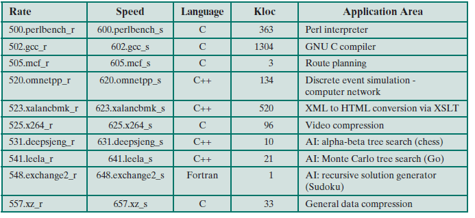

*Per-slide:* [`slides/slide-37.md`](slides/slide-37.md)

---

## 38. SPEC CPU2017 Floating Point Benchmarks {#38-spec-cpu2017-floating-point-benchmarks}

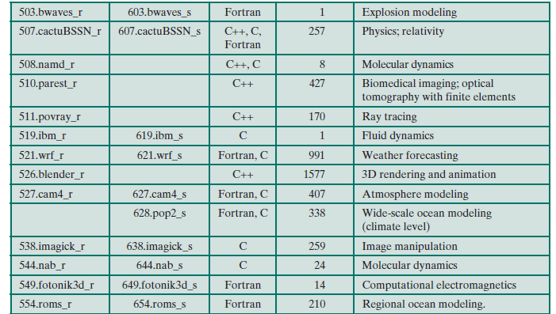

*Per-slide:* [`slides/slide-38.md`](slides/slide-38.md)

---
