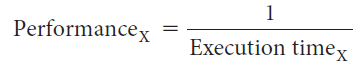
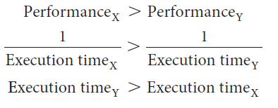

# Slide 11: Performance and Execution Time

*Chapter 2 — Performance Issues*

- To maximize performance, we want to minimize execution time for some task.
- For two computers X and Y, if the performance of X is greater than the performance of Y:
- The execution time on Y is longer than that on X, if X is faster than Y.

### Figures

