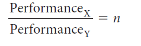
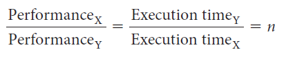

# Slide 12: Performance and Execution Time

*Chapter 2 — Performance Issues*

- In discussing a computer design, we often want to relate the performance of two different
- computers quantitatively. We will use the phrase "X is n times faster than Y" or equivalently "X is n

**times as fast as Y" to mean:**
- If X is n times as fast as Y, then the execution time on Y is n times as long as it is on X:
- We usually say "improve performance" or "improve execution time" when we mean "increase
- performance" and "decrease execution time."

### Figures

