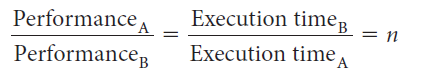
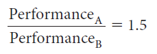
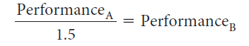

# Slide 13: Relative Performance

*Chapter 2 — Performance Issues*

- If computer A runs a program in 10 seconds and computer B runs the same program in 15
- seconds, how much faster is A than B?

**We know that A is n times as fast as B if:**
- The performance ratio is 15 / 10 = 1.5
- A is therefore 1.5 times as fast as B
- We could also say that computer B is 1.5 times slower than computer A, since
- means that

### Figures

