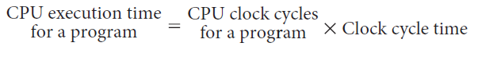
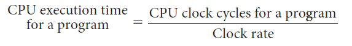

# Slide 16: CPU Time

*Chapter 2 — Performance Issues*

**CPU time:**

**Since clock rate and clock cycle time are inverses:**

**Performance improved by:**
- Reducing number of clock cycles
- Increasing clock rate

### Figures

