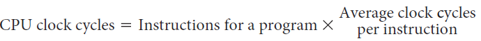

# Slide 19: Instruction Performance

*Chapter 2 — Performance Issues*

- Since the computer has to execute the instructions to run the program, the execution time must
- depend on the number of instructions in a program.
- Execution time equals the number of instructions executed multiplied by the average time per
- instruction.

**The number of clock cycles:**
- Clock cycles per instruction (CPI) is the average number of clock cycles each instruction takes
- to execute.
- Since different instructions may take different amounts of time depending on what they do, CPI is
- an average of all the instructions executed in the program.

### Figures

