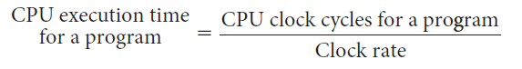
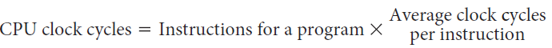

# Slide 22: CPU Performance Equation

*Chapter 2 — Performance Issues*

- We can write this basic performance equation in terms of instruction count, CPI, and clock
- cycle time
- 𝐶𝑃𝑈𝑡𝑖𝑚𝑒= 𝑖𝑛𝑠𝑡𝑟𝑢𝑐𝑡𝑖𝑜𝑛𝑐𝑜𝑢𝑛𝑡× 𝐶𝑃𝐼× 𝑐𝑙𝑜𝑐𝑘𝑐𝑦𝑐𝑙𝑒𝑡𝑖𝑚𝑒

**Since the clock rate is the inverse of the clock cycle time:**
- 𝐶𝑃𝑈𝑡𝑖𝑚𝑒= 𝑖𝑛𝑠𝑡𝑟𝑢𝑐𝑡𝑖𝑜𝑛𝑐𝑜𝑢𝑛𝑡× 𝐶𝑃𝐼
- 𝑐𝑙𝑜𝑐𝑘𝑟𝑎𝑡𝑒

### Figures

