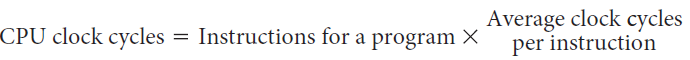

# Slide 23: CPI in More Detail

*Chapter 2 — Performance Issues*

- If different instruction classes take different numbers of cycles
- Weighted average CPI
- 
- =
- 
- =
- n
- i
- i
- i
- )
- Count
- n
- Instructio
- (CPI
- Cycles
- Clock
- 
- =
- 
- 
- 
- 
- 
- 
- 
- =
- =
- n
- i
- i
- i
- Count
- n
- Instructio
- Count
- n
- Instructio
- CPI
- Count
- n
- Instructio
- Cycles
- Clock
- CPI

### Figures

