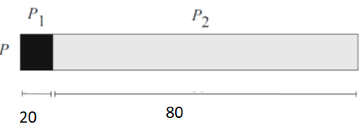

# Slide 29: Amdahl's Law

*Chapter 2 — Performance Issues*

- Assume
- we
- want
- to
- parallelize
- an
- application
- We would expect that doubling the number
- of
- processing
- units
- should
- halve
- the
- parallel execution time.
- We would expect that the speedup from
- parallelization would be a linear function of
- the number of processing units.
- Let P be a sequential program processing

**files from disk:**
- P1 scans the directory of the disk, creates
- a list of file names, and hands the list over
- to P2
- P2 passes each file to the processing unit
- for processing
- Note: P1 cannot be sped up by adding new
- processing units, because scanning the disk
- directory is a sequential process. P2 can be
- sped up.
- Suppose the sequential execution of P takes
- 100 s
- the non-parallelizable P1 runs 20 s
- the parallelizable P2 runs 80 s
- Motivation
- Example

### Figures

