# Chapter 3: A Top-Level View of Computer Function and Interconnection

**Source:** `Chapter 3 - Top Level View of Function and Interconnnection.pdf`  
**Pages / slides:** 58  
**Based on:** William Stallings, *Computer Organization and Architecture*

---

## Slide index

1. [A Top-Level View of Computer Function](#01-a-top-level-view-of-computer-function)
2. [Program Concept](#02-program-concept)
3. [What is a Program?](#03-what-is-a-program)
4. [Function of Control Unit](#04-function-of-control-unit)
5. [Components](#05-components)
6. [Computer Components - Top Level View](#06-computer-components-top-level-view)
7. [Instruction Cycle](#07-instruction-cycle)
8. [Characteristics of a Hypothetical Machine](#08-characteristics-of-a-hypothetical-machine)
9. [Example of Program Execution](#09-example-of-program-execution)
10. [Instruction Cycle - State Diagram](#10-instruction-cycle-state-diagram)
11. [Multiple Memory Access](#11-multiple-memory-access)
12. [Interrupts](#12-interrupts)
13. [Classes of Interrupts](#13-classes-of-interrupts)
14. [Transfer of Control via Interrupts](#14-transfer-of-control-via-interrupts)
15. [Program](#15-program)
16. [Interrupt Cycle](#16-interrupt-cycle)
17. [Instruction Cycle with Interrupts](#17-instruction-cycle-with-interrupts)
18. [Program Timing - Short I/O Wait](#18-program-timing-short-i-o-wait)
19. [Program Timing - Long I/O Wait](#19-program-timing-long-i-o-wait)
20. [Instruction Cycle (with Interrupts) - State Diagram](#20-instruction-cycle-with-interrupts-state-diagram)
21. [Multiple Interrupts](#21-multiple-interrupts)
22. [Multiple Interrupts](#22-multiple-interrupts)
23. [Time Sequence of Multiple Interrupts](#23-time-sequence-of-multiple-interrupts)
24. [I/O Function](#24-i-o-function)
25. [Connecting](#25-connecting)
26. [Memory Connection](#26-memory-connection)
27. [Input / Output Connection](#27-input-output-connection)
28. [CPU Connection](#28-cpu-connection)
29. [What is a Bus?](#29-what-is-a-bus)
30. [Bus Interconnection Scheme](#30-bus-interconnection-scheme)
31. [Data Bus](#31-data-bus)
32. [Address Bus](#32-address-bus)
33. [Control Bus](#33-control-bus)
34. [Problem 3.3](#34-problem-3-3)
35. [Problem 3.4](#35-problem-3-4)
36. [Single Bus Problems](#36-single-bus-problems)
37. [Traditional Bus Architecture](#37-traditional-bus-architecture)
38. [High Performance Bus Architecture](#38-high-performance-bus-architecture)
39. [Bus Types](#39-bus-types)
40. [Bus Arbitration](#40-bus-arbitration)
41. [Timing](#41-timing)
42. [Synchronous Timing Diagram](#42-synchronous-timing-diagram)
43. [Asynchronous Timing - Read Diagram](#43-asynchronous-timing-read-diagram)
44. [Asynchronous Timing - Write Diagram](#44-asynchronous-timing-write-diagram)
45. [Problem 3.11*](#45-problem-3-11)
46. [Point-to-Point Interconnect](#46-point-to-point-interconnect)
47. [Quick Path Interconnect (QPI)](#47-quick-path-interconnect-qpi)
48. [Multicore Configuration using QPI](#48-multicore-configuration-using-qpi)
49. [QPI Layers](#49-qpi-layers)
50. [Physical Interface](#50-physical-interface)
51. [QPI Physical Layer Lanes](#51-qpi-physical-layer-lanes)
52. [QPI Link Layer](#52-qpi-link-layer)
53. [QPI Routing and Protocol Layers](#53-qpi-routing-and-protocol-layers)
54. [Peripheral Component Interconnect (PCI)](#54-peripheral-component-interconnect-pci)
55. [Typical Configuration using PCIe](#55-typical-configuration-using-pcie)
56. [PCIe Layers](#56-pcie-layers)
57. [PCIe Physical Layer](#57-pcie-physical-layer)
58. [PCIe Layers](#58-pcie-layers)

---

## 01. A Top-Level View of Computer Function {#01-a-top-level-view-of-computer-function}

- and Interconnection
- Chapter 3

**Based on:**
- William Stallings
- Computer Organization and Architecture, 11th Global Edition

*Per-slide:* [`slides/slide-01.md`](slides/slide-01.md)

---

## 02. Program Concept {#02-program-concept}

- Hardwired systems are inflexible
- General purpose hardware can do different tasks, given correct control signals
- Instead of re-wiring, supply a new set of control signals

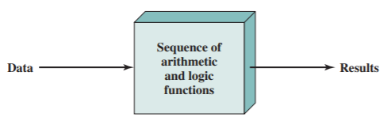

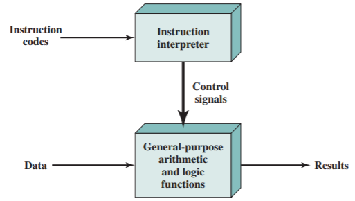

*Per-slide:* [`slides/slide-02.md`](slides/slide-02.md)

---

## 03. What is a Program? {#03-what-is-a-program}

- A sequence of steps
- For each step, an arithmetic or logical operation is done
- For each operation, a different set of control signals is needed

*Per-slide:* [`slides/slide-03.md`](slides/slide-03.md)

---

## 04. Function of Control Unit {#04-function-of-control-unit}

- For each operation, a unique code is provided
- e.g. ADD, MOVE
- A hardware segment accepts the code and issues the control signals

*Per-slide:* [`slides/slide-04.md`](slides/slide-04.md)

---

## 05. Components {#05-components}

- The Control Unit and Arithmetic and Logic Unit constitute the Central Processing Unit
- Data and instructions need to get into the system and results need to get out
- Input / Output
- Temporary storage of code and results is needed
- Main memory

*Per-slide:* [`slides/slide-05.md`](slides/slide-05.md)

---

## 06. Computer Components - Top Level View {#06-computer-components-top-level-view}

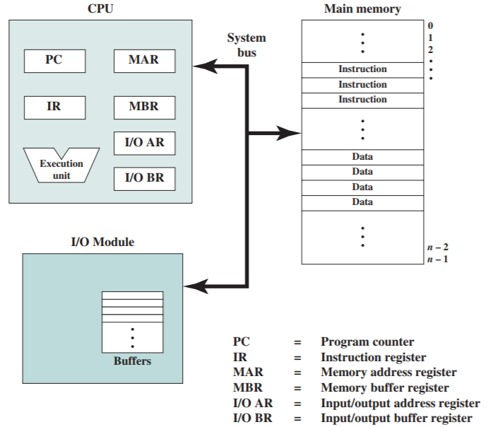

*Per-slide:* [`slides/slide-06.md`](slides/slide-06.md)

---

## 07. Instruction Cycle {#07-instruction-cycle}

- Fetch cycle
- Program Counter (PC) holds address of
- next instruction to fetch
- Processor fetches instruction from
- memory location pointed to by PC
- Increment PC
- Instruction loaded into Instruction
- Register (IR)
- Processor interprets instruction and
- performs required actions

**Execute cycle:**
- Processor-memory
- Data transfer between CPU and main
- memory
- Processor I/O
- Data transfer between CPU and I/O
- module
- Data processing
- Arithmetic or logical operation on data
- Control
- Alteration of sequence of operations
- e.g. jump
- Combination of above

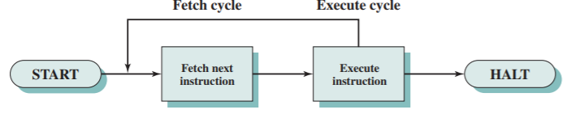

*Per-slide:* [`slides/slide-07.md`](slides/slide-07.md)

---

## 08. Characteristics of a Hypothetical Machine {#08-characteristics-of-a-hypothetical-machine}

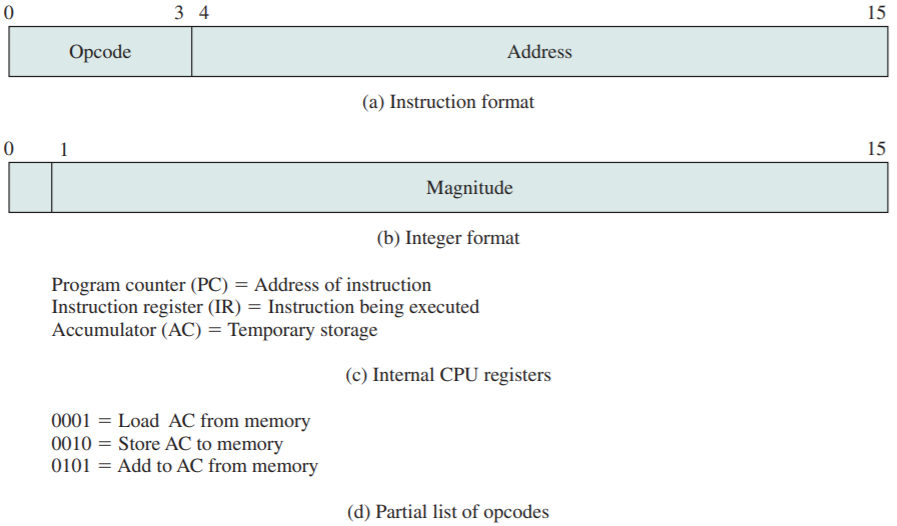

*Per-slide:* [`slides/slide-08.md`](slides/slide-08.md)

---

## 09. Example of Program Execution {#09-example-of-program-execution}

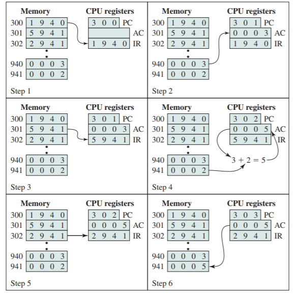

*Per-slide:* [`slides/slide-09.md`](slides/slide-09.md)

---

## 10. Instruction Cycle - State Diagram {#10-instruction-cycle-state-diagram}

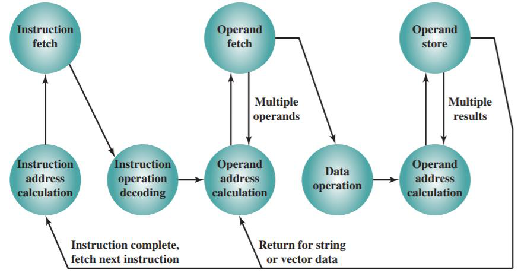

*Per-slide:* [`slides/slide-10.md`](slides/slide-10.md)

---

## 11. Multiple Memory Access {#11-multiple-memory-access}

- The execute cycle may involve more than one memory access
- For example the PDP-11 includes the instruction ADD B, A
- PDP-11 has multiple registers rather than a single accumulator

**The instruction cycle would look like this:**
- Fetch the instruction ADD B, A
- Read the contents of memory location A into a register
- Read the contents of memory location B into a different register
- Add the two values
- Write the result from the processor to memory location A
- This results in a more complicated execute cycle

*Per-slide:* [`slides/slide-11.md`](slides/slide-11.md)

---

## 12. Interrupts {#12-interrupts}

- Mechanism by which other modules (e.g. I/O) may interrupt normal sequence of processing
- May or may not resume processing after handling the interrupt
- Way to improve processing efficiency
- External devices are slower than the processor
- E.g. don't want the processor to wait for the printer
- Printer can interrupt the processor when it needs attention
- Used to stop a process when an error has occurred
- Error may or may not be recoverable

*Per-slide:* [`slides/slide-12.md`](slides/slide-12.md)

---

## 13. Classes of Interrupts {#13-classes-of-interrupts}

- Program
- e.g. overflow, division by zero
- Timer
- generated by internal processor timer
- used in pre-emptive multi-tasking
- I/O
- from I/O controller
- Hardware failure
- e.g. power failure, memory parity error

*Per-slide:* [`slides/slide-13.md`](slides/slide-13.md)

---

## 14. Transfer of Control via Interrupts {#14-transfer-of-control-via-interrupts}

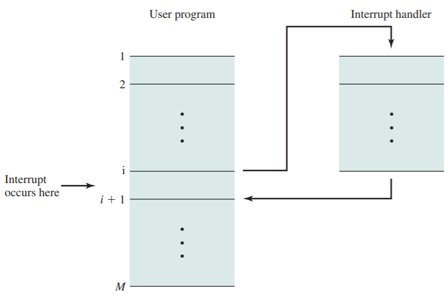

*Per-slide:* [`slides/slide-14.md`](slides/slide-14.md)

---

## 15. Program {#15-program}

- Flow
- Control

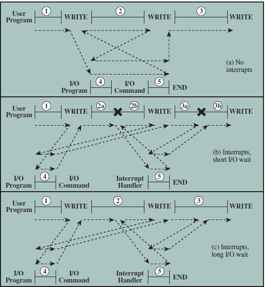

*Per-slide:* [`slides/slide-15.md`](slides/slide-15.md)

---

## 16. Interrupt Cycle {#16-interrupt-cycle}

- Added to instruction cycle
- Processor checks for interrupt
- Indicated by an interrupt signal
- If no interrupt, fetch next instruction

**If interrupt pending:**
- Suspend execution of current program
- Save context
- Set PC to start address of interrupt handler routine
- Process interrupt
- Restore context and continue interrupted program

*Per-slide:* [`slides/slide-16.md`](slides/slide-16.md)

---

## 17. Instruction Cycle with Interrupts {#17-instruction-cycle-with-interrupts}

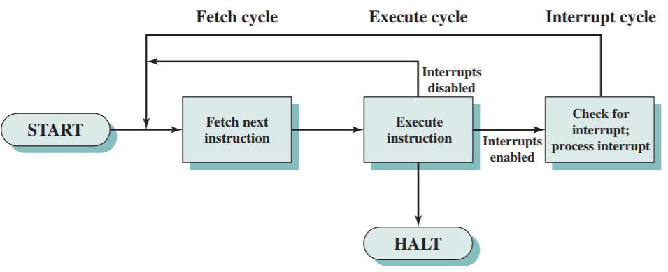

*Per-slide:* [`slides/slide-17.md`](slides/slide-17.md)

---

## 18. Program Timing - Short I/O Wait {#18-program-timing-short-i-o-wait}

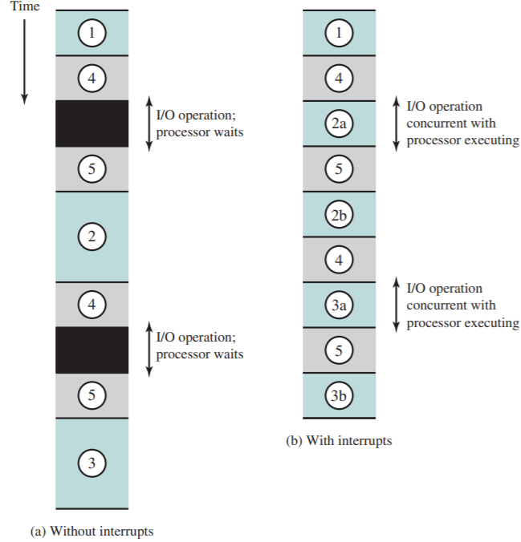

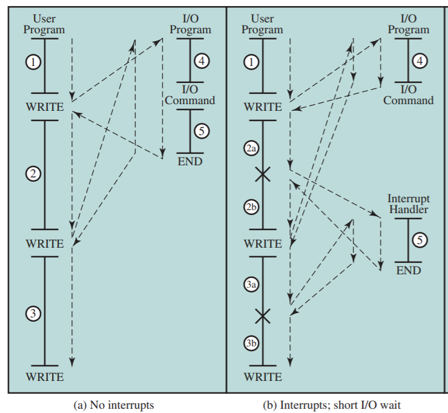

*Per-slide:* [`slides/slide-18.md`](slides/slide-18.md)

---

## 19. Program Timing - Long I/O Wait {#19-program-timing-long-i-o-wait}

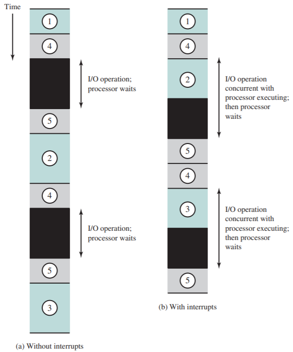

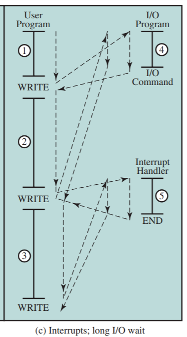

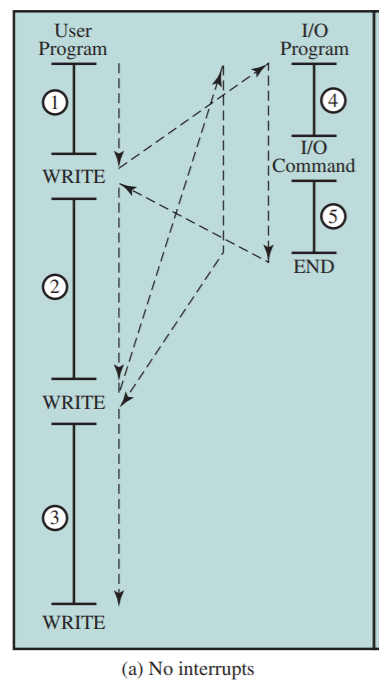

*Per-slide:* [`slides/slide-19.md`](slides/slide-19.md)

---

## 20. Instruction Cycle (with Interrupts) - State Diagram {#20-instruction-cycle-with-interrupts-state-diagram}

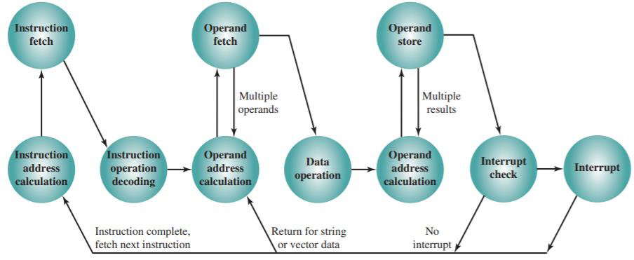

*Per-slide:* [`slides/slide-20.md`](slides/slide-20.md)

---

## 21. Multiple Interrupts {#21-multiple-interrupts}

- Disable interrupts
- Processor will ignore further interrupts whilst processing one interrupt
- Interrupts remain pending and are checked after first interrupt has been processed
- Interrupts handled in sequence as they occur
- Define priorities
- Low priority interrupts can be interrupted by higher priority interrupts
- When higher priority interrupt has been processed, processor returns to previous interrupt

*Per-slide:* [`slides/slide-21.md`](slides/slide-21.md)

---

## 22. Multiple Interrupts {#22-multiple-interrupts}

- Nested
- Sequential

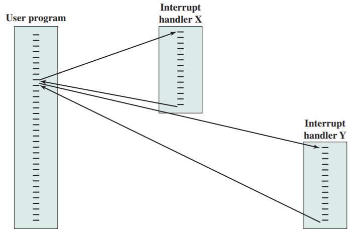

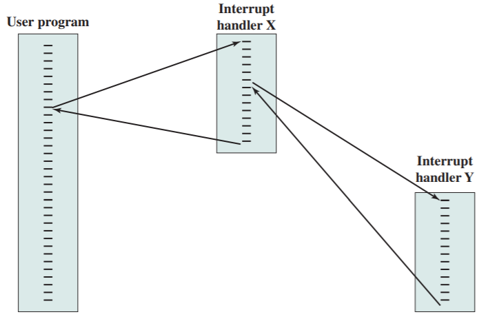

*Per-slide:* [`slides/slide-22.md`](slides/slide-22.md)

---

## 23. Time Sequence of Multiple Interrupts {#23-time-sequence-of-multiple-interrupts}

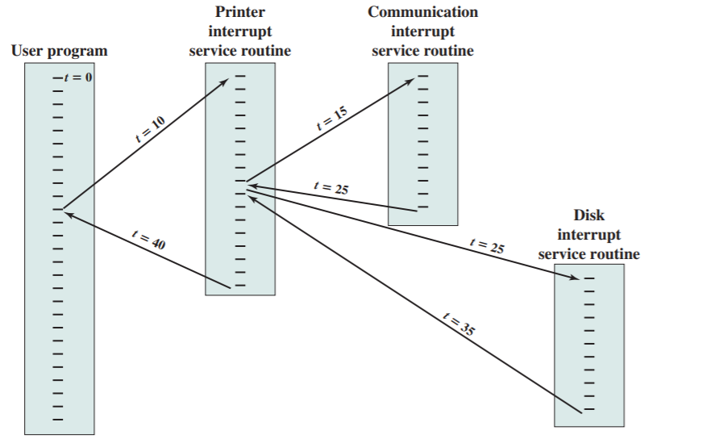

*Per-slide:* [`slides/slide-23.md`](slides/slide-23.md)

---

## 24. I/O Function {#24-i-o-function}

- An I/O module (e.g., a disk controller) can exchange data directly with the processor
- Processor can read data from or write data to an I/O module
- Processor identifies a specific device that is controlled by a particular I/O module
- I/O instructions rather than memory referencing instructions
- In some cases it is desirable to allow I/O exchanges to occur directly with memory
- The processor grants to an I/O module the authority to read from or write to memory so that
- the I/O memory transfer can occur without tying up the processor
- The I/O module issues read or write commands to memory relieving the processor of
- responsibility for the exchange
- This is known as direct memory access (DMA)

*Per-slide:* [`slides/slide-24.md`](slides/slide-24.md)

---

## 25. Connecting {#25-connecting}

- All the units must be connected
- Different type of connection for different type of unit
- Memory
- Input/Output
- CPU

*Per-slide:* [`slides/slide-25.md`](slides/slide-25.md)

---

## 26. Memory Connection {#26-memory-connection}

- Receives and sends data
- Receives addresses (of locations)
- Receives control signals
- Read
- Write
- Timing

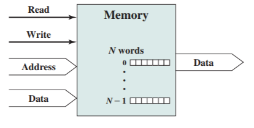

*Per-slide:* [`slides/slide-26.md`](slides/slide-26.md)

---

## 27. Input / Output Connection {#27-input-output-connection}

- Similar to memory from computer's viewpoint
- Output
- Receive data from computer
- Send data to peripheral
- Input
- Receive data from peripheral
- Send data to computer
- Receive control signals from computer
- Send control signals to peripherals
- e.g. spin disk
- Receive addresses from computer
- e.g. port number to identify peripheral
- Send interrupt signals (control)

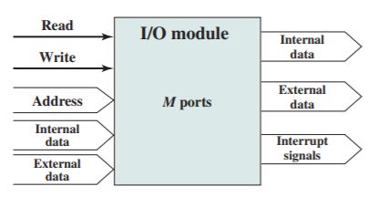

*Per-slide:* [`slides/slide-27.md`](slides/slide-27.md)

---

## 28. CPU Connection {#28-cpu-connection}

- Reads instruction and data
- Writes out data (after processing)
- Sends control signals to other units
- Receives (and acts on) interrupts

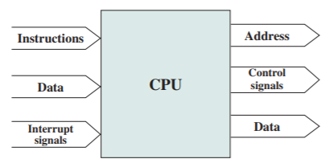

*Per-slide:* [`slides/slide-28.md`](slides/slide-28.md)

---

## 29. What is a Bus? {#29-what-is-a-bus}

- There are a number of possible interconnection systems
- Single and multiple bus structures are most common
- Examples
- Control/Address/Data bus (PC)
- Unibus (DEC-PDP)
- A communication pathway connecting two or more devices
- Usually broadcast
- Often grouped
- A number of channels in one bus
- e.g. 32 bit data bus is 32 separate single bit channels

*Per-slide:* [`slides/slide-29.md`](slides/slide-29.md)

---

## 30. Bus Interconnection Scheme {#30-bus-interconnection-scheme}

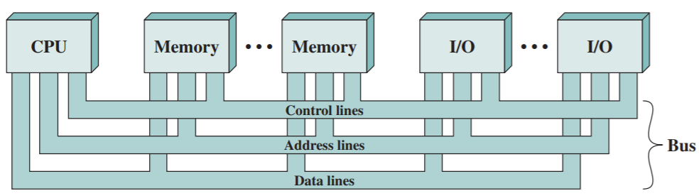

*Per-slide:* [`slides/slide-30.md`](slides/slide-30.md)

---

## 31. Data Bus {#31-data-bus}

- Carries data
- Recall that there is no difference between "data" and "instruction" at this level
- Width is a key determinant of performance
- 8, 16, 32, 64 bit

*Per-slide:* [`slides/slide-31.md`](slides/slide-31.md)

---

## 32. Address Bus {#32-address-bus}

- Identify the source or destination of data
- E.g. CPU needs to read an instruction (data) from a given location in memory
- Bus width determines maximum memory capacity of system
- E.g. 8080 has 16 bit address bus giving 64k address space

*Per-slide:* [`slides/slide-32.md`](slides/slide-32.md)

---

## 33. Control Bus {#33-control-bus}

- Control and timing information
- Memory read/write signal
- Interrupt request
- Clock signals

**If one module wishes to send data to another, it must:**
- obtain the use of the bus, and
- transfer data via the bus

**If one module wishes to request data from another, it must:**
- obtain the use of the bus, and
- transfer a request to the other module over the appropriate control and address lines
- It must then wait for that second module to send the data

*Per-slide:* [`slides/slide-33.md`](slides/slide-33.md)

---

## 34. Problem 3.3 {#34-problem-3-3}

- Consider a hypothetical 32-bit microprocessor having 32-bit instructions composed of two fields:
- the first byte contains the opcode and the remainder the immediate operand or an operand address.
- a)
- What is the maximum directly addressable memory capacity (in bytes)?
- b)

**Discuss the impact on the system speed if the microprocessor bus has:**
- i.
- a 32-bit local address bus and a 16-bit local data bus, or
- ii.
- a 16-bit local address bus and a 16-bit local data bus.
- c)
- How many bits are needed for the PC and the IR?

*Per-slide:* [`slides/slide-34.md`](slides/slide-34.md)

---

## 35. Problem 3.4 {#35-problem-3-4}

- Consider a hypothetical microprocessor generating a 16-bit address and having a 16-bit data bus.
- a)
- What is the maximum memory address space that the processor can access directly if it is
- connected to a 16-bit memory?
- b)
- What is the maximum memory address space that the processor can access directly if it is
- connected to an 8-bit memory?
- c)
- What architectural features will allow this microprocessor to access a separate I/O space?
- d)
- If an input and an output instruction can specify an 8-bit I/O port number, how many 8-bit I/O
- ports can the microprocessor support? How many 16-bit I/O ports? Explain.

*Per-slide:* [`slides/slide-35.md`](slides/slide-35.md)

---

## 36. Single Bus Problems {#36-single-bus-problems}

**Lots of devices on one bus leads to:**
- Propagation delays
- Long data paths mean that coordination of bus use can adversely affect performance
- If aggregate data transfer approaches bus capacity
- Most systems use multiple buses to overcome these problems

*Per-slide:* [`slides/slide-36.md`](slides/slide-36.md)

---

## 37. Traditional Bus Architecture {#37-traditional-bus-architecture}

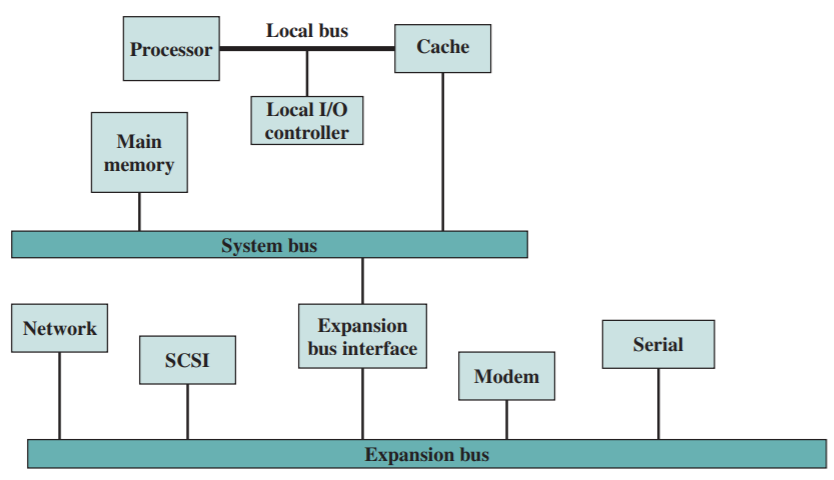

*Per-slide:* [`slides/slide-37.md`](slides/slide-37.md)

---

## 38. High Performance Bus Architecture {#38-high-performance-bus-architecture}

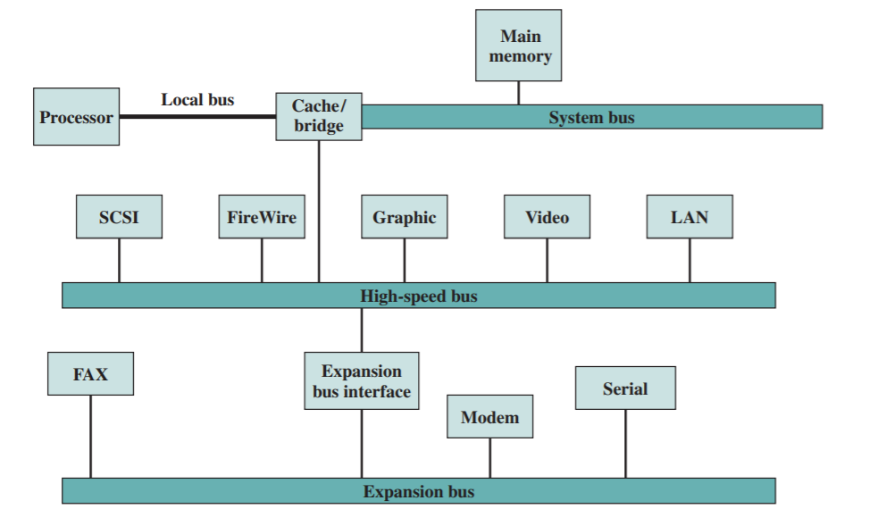

*Per-slide:* [`slides/slide-38.md`](slides/slide-38.md)

---

## 39. Bus Types {#39-bus-types}

- Dedicated
- Separate data and address lines
- Multiplexed
- Shared lines
- Address valid or data valid control line
- Advantage:
- Fewer lines
- Disadvantages:
- More complex control

*Per-slide:* [`slides/slide-39.md`](slides/slide-39.md)

---

## 40. Bus Arbitration {#40-bus-arbitration}

- More than one module controlling the bus
- E.g. CPU and DMA controller
- Only one module may control bus at one time
- Arbitration may be
- Centralized
- Single hardware device controlling bus access
- Bus controller
- Arbiter
- May be part of CPU or separate
- Distributed
- Each module may claim the bus
- Control logic on all modules

*Per-slide:* [`slides/slide-40.md`](slides/slide-40.md)

---

## 41. Timing {#41-timing}

- Coordination of events on bus
- Synchronous
- Events determined by clock signals
- Control bus includes clock line
- A single 1-0 is a bus cycle
- All devices can read clock line
- Usually sync on leading edge
- Usually a single cycle for an event
- Asynchronous

*Per-slide:* [`slides/slide-41.md`](slides/slide-41.md)

---

## 42. Synchronous Timing Diagram {#42-synchronous-timing-diagram}

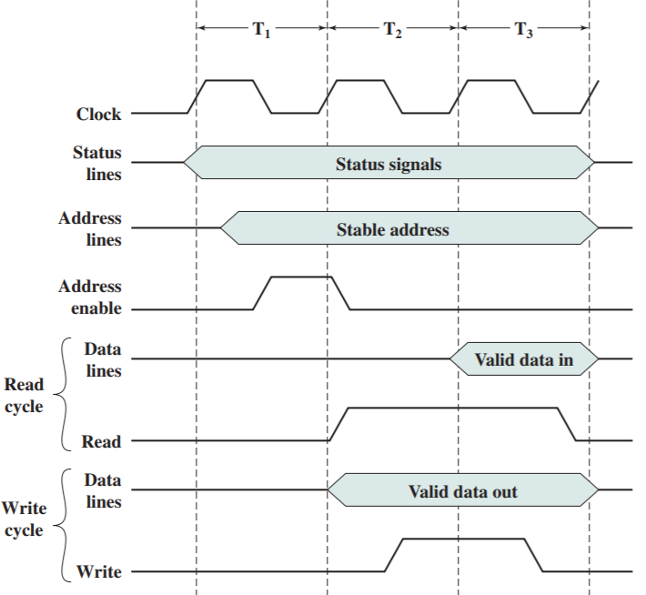

*Per-slide:* [`slides/slide-42.md`](slides/slide-42.md)

---

## 43. Asynchronous Timing - Read Diagram {#43-asynchronous-timing-read-diagram}

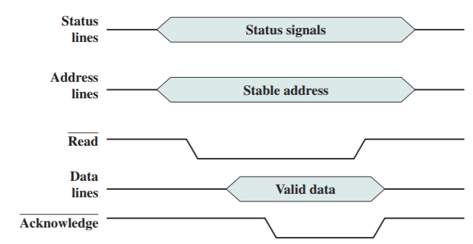

*Per-slide:* [`slides/slide-43.md`](slides/slide-43.md)

---

## 44. Asynchronous Timing - Write Diagram {#44-asynchronous-timing-write-diagram}

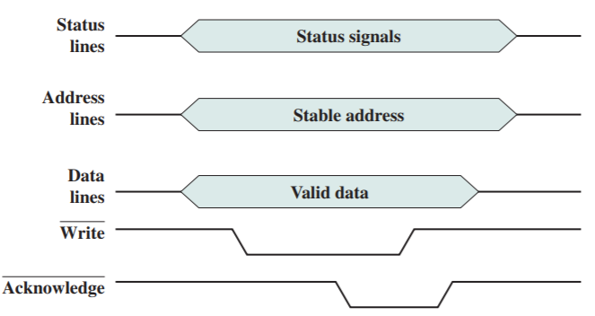

*Per-slide:* [`slides/slide-44.md`](slides/slide-44.md)

---

## 45. Problem 3.11* {#45-problem-3-11}

- For a synchronous read operation, the memory module must place the data on the bus sufficiently
- ahead of the falling edge of the Read signal to allow for signal settling.
- Assume a microprocessor bus is clocked at 20 MHz and that the Read signal begins to fall in the
- middle of the second half of T3.
- Determine the length of the memory read instruction cycle.
- When, at the latest, should memory data be placed on the bus? Allow 10 ns for the settling of
- data lines.
- * Some values differ from question in book

*Per-slide:* [`slides/slide-45.md`](slides/slide-45.md)

---

## 46. Point-to-Point Interconnect {#46-point-to-point-interconnect}

- Principal reason for change from bus to point-to-point was the electrical constraints encountered
- with increasing the frequency of wide synchronous buses
- At higher and higher data rates, it becomes difficult to perform the synchronization and arbitration
- functions in a timely fashion
- With multicore chips (multiple processors and significant memory on a single chip), the use of a
- conventional shared bus on the same chip magnified the difficulties of increasing bus data rate
- and reducing bus latency to keep up with the processors
- Compared to shared bus, point-to-point interconnect has lower latency, higher data rate, and
- better scalability

*Per-slide:* [`slides/slide-46.md`](slides/slide-46.md)

---

## 47. Quick Path Interconnect (QPI) {#47-quick-path-interconnect-qpi}

- Introduced in 2008 by Intel
- Multiple direct connections
- Direct pairwise connections to other components eliminating the need for arbitration found in
- shared transmission systems
- Layered protocol architecture
- Rather than simple use of control signals found in shared bus arrangements
- Packetized data transfer
- Data sent as a sequence of packets each of which contains control headers and error control
- codes

*Per-slide:* [`slides/slide-47.md`](slides/slide-47.md)

---

## 48. Multicore Configuration using QPI {#48-multicore-configuration-using-qpi}

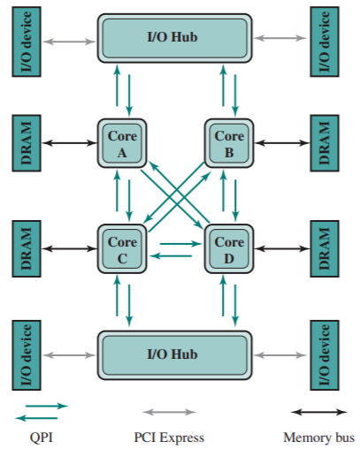

*Per-slide:* [`slides/slide-48.md`](slides/slide-48.md)

---

## 49. QPI Layers {#49-qpi-layers}

**Physical layer:**
- Actual wires carrying the signals, as well as circuitry and logic to
- support ancillary features required in the transmission and receipt
- of the 1s and 0s
- Unit of transfer is 20 bits, called a Phit (physical unit)

**Link layer:**
- Responsible for reliable transmission and flow control
- Unit of transfer is an 80-bit Flit (flow control unit)

**Routing layer:**
- Provides the framework for directing packets through
- the fabric

**Protocol layer:**
- High-level set of rules for exchanging packets of data between
- devices.
- Comprised of an integral number of Flits

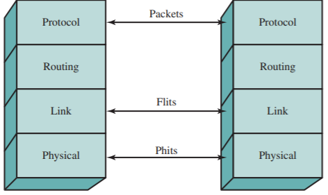

*Per-slide:* [`slides/slide-49.md`](slides/slide-49.md)

---

## 50. Physical Interface {#50-physical-interface}

**The QPI port consists of 84 individual links grouped as:**
- Each data path consists of a pair of wires that
- transmits data one bit at a time; each pair is referred
- to as a lane
- There are 20 data lanes in each direction (transmit
- and receive), plus a clock lane in each direction
- QPI is capable of transmitting 20 bits in parallel in
- each direction
- The 20-bit unit is referred to as a Phit
- The form of transmission on each lane is known as
- differential signaling, or balanced transmission -
- signals are transmitted as a current that travels
- down one conductor and returns on the other
- The binary value depends on the voltage difference
- Typically, one line has a positive voltage value and
- the other line has zero voltage, and one line is
- associated with binary 1 and one line is associated
- with binary 0

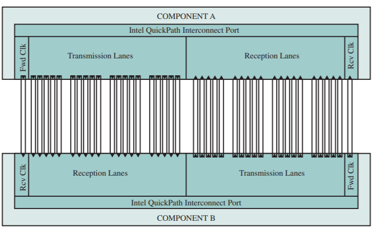

*Per-slide:* [`slides/slide-50.md`](slides/slide-50.md)

---

## 51. QPI Physical Layer Lanes {#51-qpi-physical-layer-lanes}

- The physical layer also manages the translation between 80-bit flits and 20-bit phits using
- multilane distribution.
- The flits can be considered as a bit stream that is distributed across the data lanes in a round-
- robin fashion.
- This enables QPI to achieve very high data rates by implementing the physical link between two
- ports as multiple parallel channels.

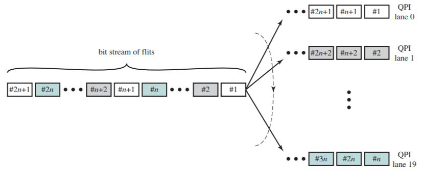

*Per-slide:* [`slides/slide-51.md`](slides/slide-51.md)

---

## 52. QPI Link Layer {#52-qpi-link-layer}

- Performs two key functions: flow control and error control
- Operate on the level of the flit (flow control unit)
- Each flit consists of a 72- bit message payload and an 8-bit error control code (cyclic
- redundancy check - CRC)
- Flow control function
- Needed to ensure that a sending QPI entity does not overwhelm a receiving QPI entity by
- sending data faster than the receiver can process the data and clear buffers for more
- incoming data
- Error control function
- Detects and recovers from bit errors

*Per-slide:* [`slides/slide-52.md`](slides/slide-52.md)

---

## 53. QPI Routing and Protocol Layers {#53-qpi-routing-and-protocol-layers}

- Routing Layer
- Used to determine the course that a packet will traverse across the available system
- interconnects
- Defined by firmware and describes the possible paths that a packet can follow
- Protocol Layer
- Packet is defined as the unit of transfer
- One key function performed is a cache coherency protocol - main memory values held in
- multiple caches are consistent
- A typical data packet payload is a block of data being sent to or from a cache

*Per-slide:* [`slides/slide-53.md`](slides/slide-53.md)

---

## 54. Peripheral Component Interconnect (PCI) {#54-peripheral-component-interconnect-pci}

- A popular high bandwidth, processor independent bus that can function as a mezzanine or
- peripheral bus
- Delivers better system performance for high speed I/O subsystems
- PCI Special Interest Group (SIG)
- Created to develop further and maintain the compatibility of the PCI specifications
- PCI Express (PCIe)
- Point-to-point interconnect scheme intended to replace bus-based schemes such as PCI
- Key requirement is high capacity to support the needs of higher data rate I/O devices, such as
- Gigabit Ethernet
- Support time dependent data streams

*Per-slide:* [`slides/slide-54.md`](slides/slide-54.md)

---

## 55. Typical Configuration using PCIe {#55-typical-configuration-using-pcie}

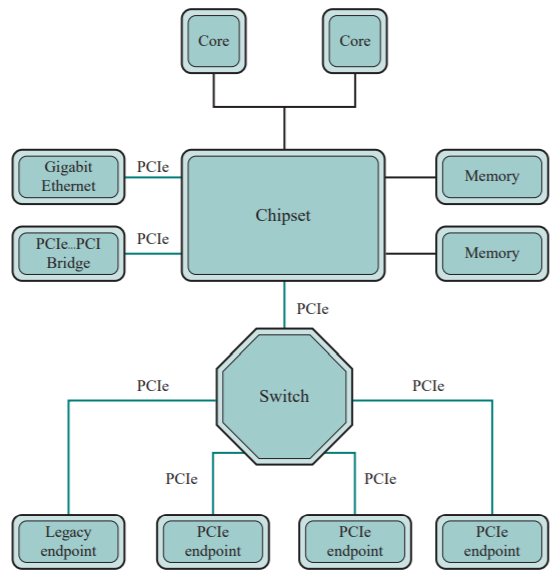

*Per-slide:* [`slides/slide-55.md`](slides/slide-55.md)

---

## 56. PCIe Layers {#56-pcie-layers}

- Physical Layer - the physical wires that carry the data
- Also includes the circuitry and logic to support the
- transmission and receipt of 1's and 0's
- Data Link Layer - responsible for reliable
- transmission and flow control
- Data packets at the data link layer called DLLPs
- Transaction Layer - generates and consumes data
- packets and manages the flow between two
- components
- Data packets at the transaction layer called TLPs

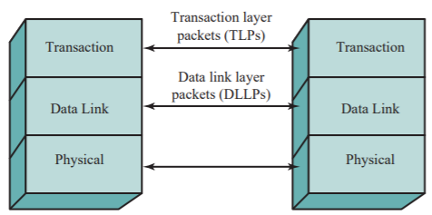

*Per-slide:* [`slides/slide-56.md`](slides/slide-56.md)

---

## 57. PCIe Physical Layer {#57-pcie-physical-layer}

- PCIe operates in a similar manner to QPI with the exception that lanes are bidirectional and the
- number of lanes on a PCIe port can be 1, 4, 6, 16, of 32
- Bits sent to lanes in a round-robin scheme
- At each physical lane data are buffered and processed 16 bytes (128 bits) at a time
- Each block is encoded into a 130 bit code word for transmission
- There in no common clock; the receiver looks for transitions in the data for synchronization
- The extra 2 bits ensure that in a long sequence of 1's there are at least some 0's to provide these
- transitions
- PCIe multilane distribution

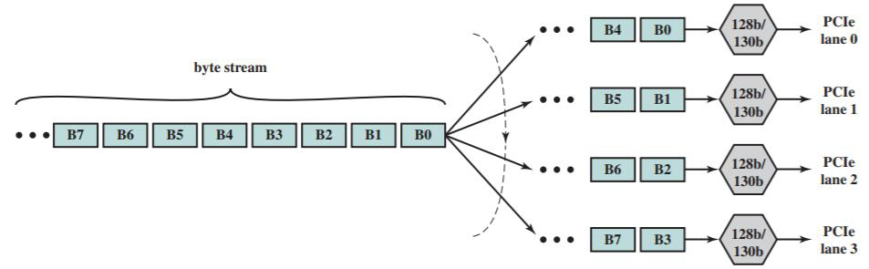

*Per-slide:* [`slides/slide-57.md`](slides/slide-57.md)

---

## 58. PCIe Layers {#58-pcie-layers}

- Sends packets between two devices
- Adds error checking and address bits to each
- TLP to ensure they arrive at the correct
- device

**Packets fall into the following categories:**
- Flow control - regulate the rate at which
- TLPs and DLLPs can be transmitted
- Power management - manage power
- platform budgeting
- ACK - acknowledge the receipt of a valid
- data packet
- NAK - acknowledge the receipt of an
- invalid data packet; the packet must be
- resent
- Receives read and write requests from the
- software above the TL and creates request
- packets for transmission to a destination via the
- link layer
- Most transactions use a split transaction
- technique
- A request packet is sent out by a source
- PCIe device which then waits for a
- response
- TL messages and some write transactions are
- posted transactions (meaning that no response
- is expected)
- TL packet format supports 32-bit memory
- addressing and extended 64-bit memory
- addressing
- Data Link Layer
- Transaction Layer

*Per-slide:* [`slides/slide-58.md`](slides/slide-58.md)

---
