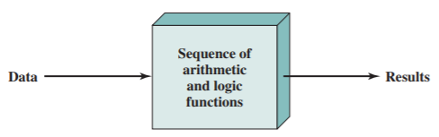
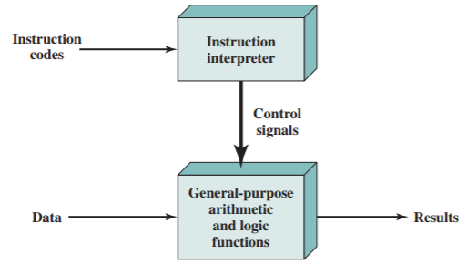

# Slide 2: Program Concept

*Chapter 3 — A Top-Level View of Computer Function and Interconnection*

- Hardwired systems are inflexible
- General purpose hardware can do different tasks, given correct control signals
- Instead of re-wiring, supply a new set of control signals

### Figures

