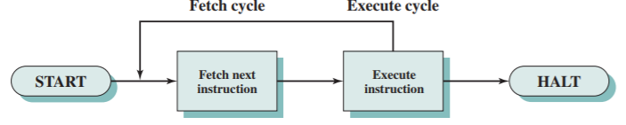

# Slide 7: Instruction Cycle

*Chapter 3 — A Top-Level View of Computer Function and Interconnection*

- Fetch cycle
- Program Counter (PC) holds address of
- next instruction to fetch
- Processor fetches instruction from
- memory location pointed to by PC
- Increment PC
- Instruction loaded into Instruction
- Register (IR)
- Processor interprets instruction and
- performs required actions

**Execute cycle:**
- Processor-memory
- Data transfer between CPU and main
- memory
- Processor I/O
- Data transfer between CPU and I/O
- module
- Data processing
- Arithmetic or logical operation on data
- Control
- Alteration of sequence of operations
- e.g. jump
- Combination of above

### Figures

