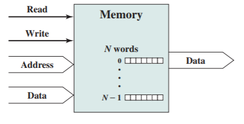

# Slide 26: Memory Connection

*Chapter 3 — A Top-Level View of Computer Function and Interconnection*

- Receives and sends data
- Receives addresses (of locations)
- Receives control signals
- Read
- Write
- Timing

### Figures

