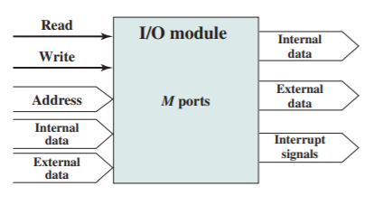

# Slide 27: Input / Output Connection

*Chapter 3 — A Top-Level View of Computer Function and Interconnection*

- Similar to memory from computer's viewpoint
- Output
- Receive data from computer
- Send data to peripheral
- Input
- Receive data from peripheral
- Send data to computer
- Receive control signals from computer
- Send control signals to peripherals
- e.g. spin disk
- Receive addresses from computer
- e.g. port number to identify peripheral
- Send interrupt signals (control)

### Figures

