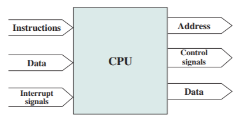

# Slide 28: CPU Connection

*Chapter 3 — A Top-Level View of Computer Function and Interconnection*

- Reads instruction and data
- Writes out data (after processing)
- Sends control signals to other units
- Receives (and acts on) interrupts

### Figures

