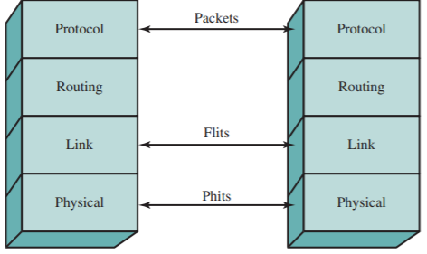

# Slide 49: QPI Layers

*Chapter 3 — A Top-Level View of Computer Function and Interconnection*

**Physical layer:**
- Actual wires carrying the signals, as well as circuitry and logic to
- support ancillary features required in the transmission and receipt
- of the 1s and 0s
- Unit of transfer is 20 bits, called a Phit (physical unit)

**Link layer:**
- Responsible for reliable transmission and flow control
- Unit of transfer is an 80-bit Flit (flow control unit)

**Routing layer:**
- Provides the framework for directing packets through
- the fabric

**Protocol layer:**
- High-level set of rules for exchanging packets of data between
- devices.
- Comprised of an integral number of Flits

### Figures

