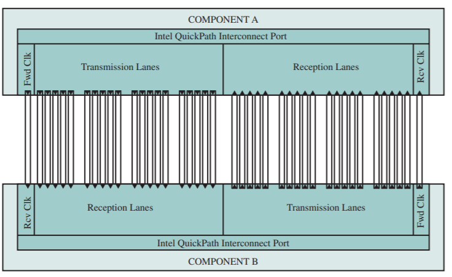

# Slide 50: Physical Interface

*Chapter 3 — A Top-Level View of Computer Function and Interconnection*

**The QPI port consists of 84 individual links grouped as:**
- Each data path consists of a pair of wires that
- transmits data one bit at a time; each pair is referred
- to as a lane
- There are 20 data lanes in each direction (transmit
- and receive), plus a clock lane in each direction
- QPI is capable of transmitting 20 bits in parallel in
- each direction
- The 20-bit unit is referred to as a Phit
- The form of transmission on each lane is known as
- differential signaling, or balanced transmission -
- signals are transmitted as a current that travels
- down one conductor and returns on the other
- The binary value depends on the voltage difference
- Typically, one line has a positive voltage value and
- the other line has zero voltage, and one line is
- associated with binary 1 and one line is associated
- with binary 0

### Figures

