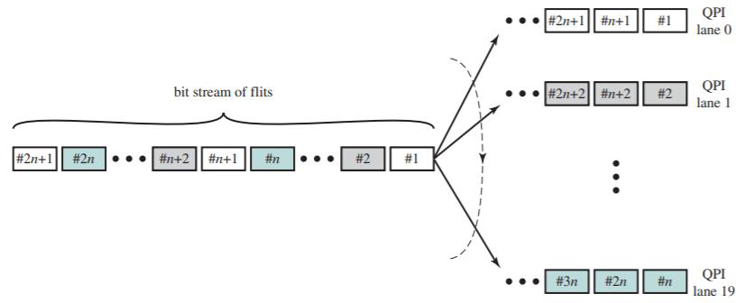

# Slide 51: QPI Physical Layer Lanes

*Chapter 3 — A Top-Level View of Computer Function and Interconnection*

- The physical layer also manages the translation between 80-bit flits and 20-bit phits using
- multilane distribution.
- The flits can be considered as a bit stream that is distributed across the data lanes in a round-
- robin fashion.
- This enables QPI to achieve very high data rates by implementing the physical link between two
- ports as multiple parallel channels.

### Figures

