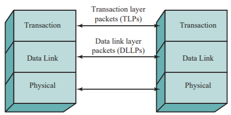

# Slide 56: PCIe Layers

*Chapter 3 — A Top-Level View of Computer Function and Interconnection*

- Physical Layer - the physical wires that carry the data
- Also includes the circuitry and logic to support the
- transmission and receipt of 1's and 0's
- Data Link Layer - responsible for reliable
- transmission and flow control
- Data packets at the data link layer called DLLPs
- Transaction Layer - generates and consumes data
- packets and manages the flow between two
- components
- Data packets at the transaction layer called TLPs

### Figures

