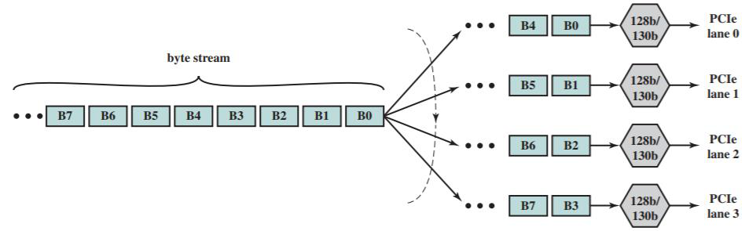

# Slide 57: PCIe Physical Layer

*Chapter 3 — A Top-Level View of Computer Function and Interconnection*

- PCIe operates in a similar manner to QPI with the exception that lanes are bidirectional and the
- number of lanes on a PCIe port can be 1, 4, 6, 16, of 32
- Bits sent to lanes in a round-robin scheme
- At each physical lane data are buffered and processed 16 bytes (128 bits) at a time
- Each block is encoded into a 130 bit code word for transmission
- There in no common clock; the receiver looks for transitions in the data for synchronization
- The extra 2 bits ensure that in a long sequence of 1's there are at least some 0's to provide these
- transitions
- PCIe multilane distribution

### Figures

